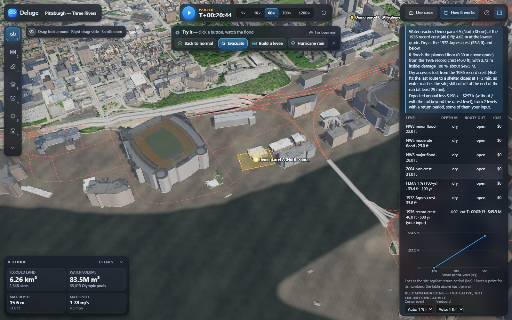
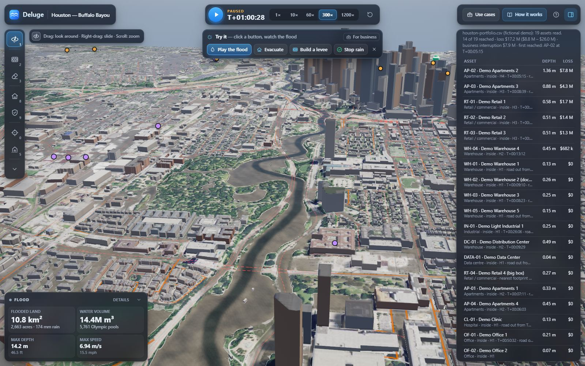
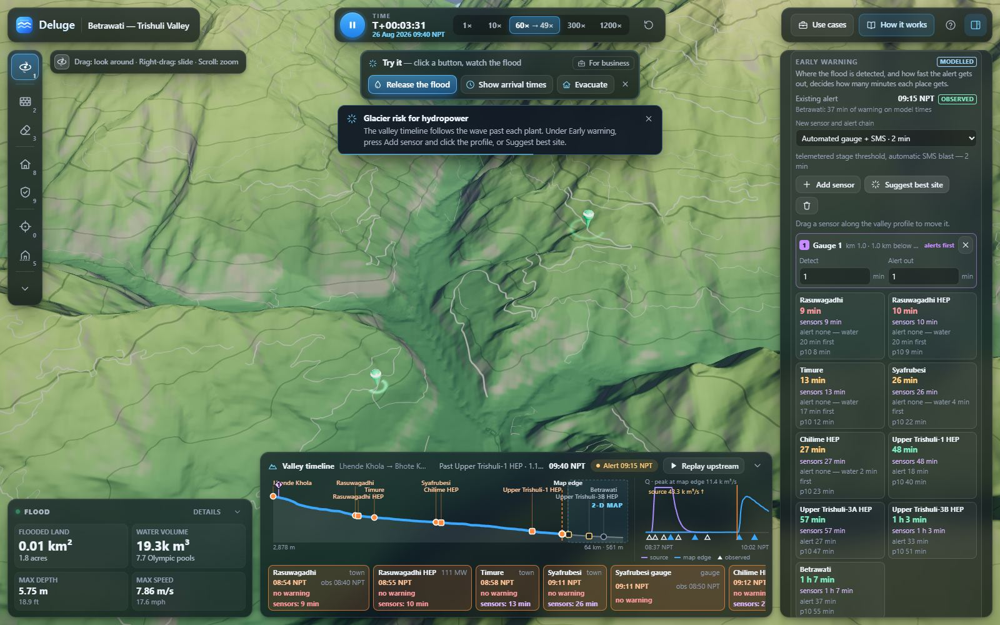
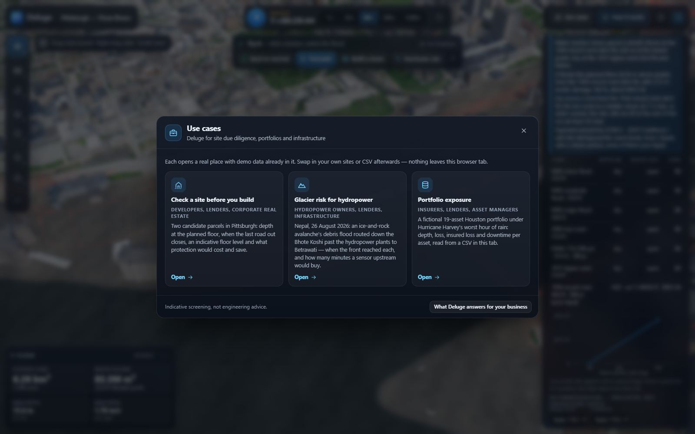

# Deluge for business

*For the owner and for prospective customers. October 2026.*

Deluge is a flood simulator that runs in a browser tab: real USGS terrain, real buildings and streets, and the 2-D
shallow-water equations solved on the GPU fast enough to change something and watch the flood again. This document
is the business case for it: who should pay, for which question, what it answers that the incumbents do not, and how
far its numbers can be trusted.

Market figures, competitor notes, regulation and the loss-model sources come from
[docs/research/business-case.md](docs/research/business-case.md) (confidence-tagged: [V] verified, [S] secondary,
[M] memory, [I] illustrative). The glacier modelling is in [docs/research/glacier-hazard-chain.md](docs/research/glacier-hazard-chain.md).
Every number in [§4](#4-three-worked-stories-with-the-apps-own-numbers) was produced by the app itself, on the
demo data that ships with it, and can be reproduced from the links given there.

**Contents:** [1 The problem](#1-the-problem) · [2 Who buys, and why](#2-who-buys-and-why) ·
[3 What Deluge does that incumbents don't](#3-what-deluge-does-that-incumbents-dont) ·
[4 Worked stories](#4-three-worked-stories-with-the-apps-own-numbers) · [5 Pricing](#5-pricing-hypotheses) ·
[6 Go-to-market](#6-go-to-market) · [7 Roadmap](#7-roadmap) · [8 Limitations](#8-honest-limitations) ·
[9 Try it](#9-try-it)

---

## 1. The problem

Floods are the most expensive disasters there are and most of the bill is uninsured. Harvey cost ≈ $125 B, Helene
≈ $79.6 B with 219 deaths, and only ~1–5 % of homes in western North Carolina carried flood cover [S]. Downtime does
more damage to a business than drywall: Harvey shut Houston warehouses for about a month, and one flooded plant
(Baxter, Marion NC) took out ~60 % of US IV-fluid supply and an estimated $100–190 M of revenue in a quarter [S].
Mountain valleys are the new frontier. The South Lhonak outburst destroyed the 1,200 MW Teesta-III dam in 2023, and
the August 2026 Langtang flood severely damaged 431 MW of Nepali generation [S].

The people who have to decide something about a specific place each ask a small, concrete question:

* a **developer, lender or corporate real-estate team**: *is this parcel a good place to build, how do people get
  out, and what would protection cost and save?*
* an **insurer, lender or asset manager**: *what is our portfolio exposed to, asset by asset?*
* a **hydropower owner or infrastructure lender**: *how many minutes of warning would a glacier flood give each
  plant, and what would a sensor upstream buy?*
* a **municipality or its engineer**: *does this wall pass a FEMA benefit–cost test, and who gets wetter?*

Today they get a static answer: a flood-zone line, a 1–10 risk score, or a return-period raster from a hazard
vendor. If they want to know what changes when the floor goes up 1 m, when a wall is built or when a sensor moves
5 km up the valley, they commission a hydraulic study that takes weeks and costs five figures, for one design.

## 2. Who buys, and why

Ranked by fit with what the product does today, and by how directly the question turns into money.

| # | Segment | The job | What Deluge gives them today | Fit |
|---|---|---|---|---|
| 1 | **Developers, site-selection and corporate real estate** (and the lenders who finance them) | Acquisition due diligence: depth at the planned floor, egress, a defensible floor level, what protection costs | **Site check**: a parcel swept through NWS / FEMA / historic levels — or, at any US address, NOAA Atlas 14 rain return periods — → depth, arrival, egress closure, loss, EAL, indicative finished floor, mitigation BCR, printable assessment | **5** |
| 2 | **Lenders, insurers, MGAs, asset managers** | Portfolio exposure, accumulation, event response; the lender's or insurer's question about one asset | **Impact & loss** with a portfolio CSV: per-asset depth, speed, hazard class, loss range, business interruption, insured loss after deductible and limit | 3–4 (they own cat models; they buy event views, new regions and explainability) |
| 3 | **Hydropower and mountain infrastructure** (owners, IFC PS4 lenders, insurers with GLOF sub-limits) | How much warning each plant gets; where a sensor pays; what the headworks see | **Hazard chain + Early warning**: a lake outburst or avalanche routed down the valley, front times at each plant, lead time per sensor design, best sensor site, ensemble p10 | **5 — the wedge**: no mainstream vendor offers interactive GLOF routing |
| 4 | **Municipalities, counties and their engineers** | A benefit–cost analysis for a FEMA HMA / BRIC / FMA application; visuals for a public meeting | Before/after loss with a drawn wall, wall cost, BCR with its uncertainty range at 7 % (FEMA's default) and 3.1 %, a break-even cost and a FEMA BCA Toolkit appendix, who gets wetter | 4–5 (BRIC was court-restored; a $1 B NOFO closed July 2026 [S]) |
| 5 | **Dam owners and their dam-safety engineers; emergency managers below them** | Breach inundation maps for an Emergency Action Plan (FEMA P-946; state dam-safety rules, which require EAPs for high-hazard dams), the first screen before a consultant's study, and the tabletop exercise | **Dam-breach inundation**: any of ~55,000 NID dams, sunny-day or flood-induced, eight published breach relations as a low / central / high band, the wave on the real valley, arrival times and depths downstream, then Site check / Impact & loss on what it reaches | 4 (a screen, not the stamped EAP map; the owner of a high-hazard dam still needs the engineer — Deluge makes that study's scope and the tabletop exercise cheaper) |
| 6 | **Coastal developers, lenders and insurers** | How often the sea reaches this parcel, today and in 2050 | **Coastal surge exposure**: the nearest NOAA tide gauge's 1- to 100-year still-water levels on the site, egress, EAL, and the same ladder with NOAA 2022 sea-level rise | 4 (still water at one gauge, no waves: a screen next to the FIRM's VE/AE zones, not instead of them) |

Why lead with segment 1: the decision is concrete and near-term (buy the parcel or not, set the floor height), a
single seat can use the answer the same week, and the competing alternative is a consultant study, not a data
licence. Lenders come with it, because the same assessment answers the lender's question.

Regulation is a weak lever in the US (the SEC climate rule is dead, California SB 261 is enjoined) and a slower one
abroad (ISSB / IFRS S2 in 35 jurisdictions, CSRD narrowed) [S]; sell on avoided loss, lender and insurer questions
and grant money, not compliance ([business-case.md §A.3](docs/research/business-case.md#a3-regulatory-status-as-of-oct-2026-state-it-accurately-in-sales-material)).

## 3. What Deluge does that incumbents don't

The incumbents (Fathom/Swiss Re, First Street, Jupiter, ICEYE, Moody's RMS, Verisk, KatRisk, JBA, Floodbase, XDI,
ClimateCheck; [business-case.md §B](docs/research/business-case.md#b-competitors-and-positioning)) sell precomputed
hazard layers, scores, catastrophe models or observed footprints. Deluge is not trying to replace a catastrophe
model. It sits at the moment *before* the decision, when someone needs to try options:

1. **Interactive what-if.** Raise the river, add rain, move a wall, and the flood is solved again in seconds on the
   user's own GPU. Not a lookup in a precomputed raster.
2. **Mitigation design with a benefit–cost ratio in the browser.** Draw a wall or levee; Impact & loss books the
   avoided loss, the buildings the wall makes *wetter*, the wall's planning cost and the BCR at 7 % (the FEMA default
   again since June 2025) and 3.1 %. Site check sizes floor elevation, a perimeter wall, a levee and dry
   floodproofing for one parcel, with FEMA TB-3 and ASCE 24-14 rules applied. *Compare designs* puts designs side by
   side as an investment: avoided EAL, present values over each design's FEMA useful life, a BCR with its range, the
   break-even cost, and an appendix of the inputs an engineer transcribes into FEMA's BCA Toolkit.
3. **Egress and evacuation.** Each site gets the time its *last* dry road route to a shelter closes, against the time
   the water arrives, from the road network and the simulated flood. A live evacuation route re-plans as streets go
   under. Then how many occupants get out before that: departures after the alert follow a published flood-warning
   response curve, the cars queue at the route's bottleneck, and the clearance time is set against the route window.
   Scores and rasters do not say when you can still leave.
4. **Glacier hazard chains and early-warning design.** A lake outburst or ice-rock avalanche is routed tens of
   kilometres down a valley in a worker, drives the 2-D flood at the map edge, and gives every town, bridge and
   power plant a front time. Drop a sensor on the valley profile, and every place's lead time updates; the optimiser
   finds the best single site.
5. **Ensemble probability.** The Uncertainty section runs the 2-D flood as a Latin-hypercube ensemble (12 members by
   default) with inflow, rain, river stage, Manning's n and the elevation model perturbed. It gives a flood-probability
   map, p10 / p50 / p90 of flooded area and loss, and "floods in 7 of 12 members" on every Site check site and
   portfolio asset; the glacier chain runs its own 27-member ensemble for p10 front times. The spread is sensitivity to
   stated input bands, not a calibrated probability, and the panel says so (see [§8](#8-honest-limitations)).
6. **Nothing leaves the laptop.** Portfolios and sites are parsed in the tab; the app has no backend, and its
   Content-Security-Policy would block an upload. The same static bundle can be hosted on a customer's intranet.
7. **Built to be checked.** Open, cited damage curves (JRC 2017), hazard classes (AIDR, FD2321), named constants with
   their sources, mass conservation shown on screen, and every report carries its methods and limits.

## 4. Three worked stories, with the app's own numbers

All three are set up by the in-app **Use cases** dialog or a `?usecase=` link (see [§9](#9-try-it)), on bundled demo
data. They were run on this branch on a Windows desktop GPU in October 2026, through the dev harness
(`window.__deluge`) and the app's own panels and exports; the scripts that drove them are summarised in each story.
Re-running moves the last digit or two, and §4.1 notes one place where it moves much more.

### 4.1 Developer: two candidate parcels in Pittsburgh (`?usecase=site`)

*The planned building:* a 6-storey apartment block, $45 M replacement value, first floor 0.3 m above grade.
*Parcel A* is a surface lot on the North Shore between the stadiums (outlined, ground ≈ 222.2 m). *Parcel B* is the
same building on the higher ground of Allegheny Center, 700 m inland (ground ≈ 234.6 m). Both are fictional
candidates on real terrain.

**Run sweep** (the default ladder of seven levels, 30 simulated minutes each, both parcels at once) took **27–37 s**
of wall-clock time. On the calm river Parcel A is dry, with a dry route to the Mount Washington shelter (Grandview Ave).

| Level (Ohio River at the Point) | Return period | Parcel A — North Shore | Parcel B — Allegheny Center |
|---|---|---|---|
| NWS minor / moderate / major flood (22 / 25 / 28 ft) | — | dry, route open | dry, route open |
| 2004 Ivan crest (31 ft) | — | dry, route open | dry, route open |
| FEMA 1 % level (35.4 ft) | 100 yr (published) | dry, route open | dry, route open |
| 1972 Agnes crest (35.8 ft) | — | dry, route open | dry, route open |
| **1936 record crest (46 ft)** | none published | **4.0 m at the lowest grade, 3.7 m above the planned floor; last dry route to a shelter closes at T+3 min, as the water arrives, and stays cut ≥ 28 min; loss $7.5 M (15 % damage)** | dry, route open |

What the verdict says, in the app's words for Parcel A: *"Expected annual loss $0: the one level with a return
period does not damage the planned building. The level that does (1936 record crest) has no published return period
— enter one to count it."* That is the honest answer, and it is the due-diligence point: the 1 % screen passes the
North Shore parcel, while the flood of record puts 4 m of water in it and cuts its egress before anyone could leave.

The user can then put a number on the record crest. **With a user-entered 500-year return period** for 1936 (an
assumption, labelled "your input" in the app and in the report) and the 1936 crest as the design event:

* expected annual loss **$30 k – $45 k per year** (without / with the tail beyond the rarest level);
* indicative finished floor **4.32 m above the lowest grade** (design water 225.74 m + 0.30 m ASCE 24-14 freeboard),
  4.02 m higher than planned;
* **raising the floor** avoids $37 k/yr and pays at 7 % over FEMA's 30-year useful life for raising a home if it costs **≤ $463 k**;
* a 361 m perimeter **floodwall**, 4.3 m high: $14.6 M ($7.3–21.9 M), **BCR 0.0–0.1**; an earthen **levee**: $6.1 M,
  BCR 0.1–0.2 (and it needs a 29 m strip all round);
* **dry floodproofing**: not applicable (3.7 m of design water; FEMA TB-3 stops at 0.9 m, and at 5 ft/s).

Leaving by road, Parcel A (a 6-storey apartment block: 2,494 occupants at the IBC design load, 1,247 cars) shows why
egress needs a clock as well as a map. Even warned three hours ahead, only **57 %** of its occupants are out by car
before the last route closes: the clearance takes 5 h 22 min against a 3 h 01 min window, set by how slowly people
start to leave rather than by the queue. A prepared population with two exit lanes gets **89 %** out and the site
clears.

At the scale of the neighbourhood, *Compare designs* asks the same question as an investment. The one-click North
Shore levee avoids **$11.7 M a year**; at FEMA's 7 % over its 50-year useful life its **BCR is 0.85, with a range of
0.38–1.72** over the damage curves, the cost band and the EAL tail, so the panel's verdict is "uncertain", not "no".
Its break-even cost is $161 M against a $190 M estimate. Every BCR comes with its range and the list of uncertainties
it includes; once an ensemble has run, the p10 / p50 / p90 BCR is shown too (30 simulated minutes per level; shorter
runs are not settled).

Parcel B stays dry at every level up to the 1936 record with its route open: EAL $0, no floor requirement. The
comparison a developer takes away: **B needs nothing; A is fine for the 1 % event, takes 4 m and loses its egress in
the record flood, and the only protection that pays is a higher floor.**

*Run-to-run sensitivity, stated plainly:* in two of four sweeps, Parcel A's peak water speed at the 1936 crest crossed
the fast-water threshold and the loss was booked as total, **$49.5 M (100 %)** instead of $7.5 M; with the same
500-year assumption the EAL is then **$198 k – $297 k per year** instead of $30 k – $45 k (the screenshot below is one
of those runs). The depth, the egress time and the parcel comparison did not change. A result that tips on a
threshold like this is exactly what the Uncertainty ensemble is for: run it on the scene and the Site check card
reports how many members flood the parcel and the p10 / p50 / p90 depth, instead of quoting one run.



### 4.2 Insurer or lender: a 19-asset Houston portfolio under Harvey's worst hour (`?usecase=portfolio`)

*The portfolio:* [public/demo/houston-portfolio.csv](public/demo/houston-portfolio.csv), **fictional**: six
warehouses and light-industrial units (two dock-high), a distribution centre, a data centre, four retail stores,
four apartment complexes, a clinic and two offices, every one pinned to a real footprint in the Houston preset and
named "Demo …", with replacement and contents values, revenue, margin, deductible and limit. *The scenario:* the
Houston preset's Harvey hour, 173 mm/h over the city with Buffalo Bayou at its 2017 crest, run for **one simulated
hour** from a reset, then Recompute in Impact & loss and the per-asset CSV export.

| Portfolio after one hour | |
|---|---|
| Assets reached by water | **15 of 19** (all 19 matched to a footprint, one of them to the nearest footprint 13 m away) |
| Physical loss, structure + contents | **$17.3 M** (±1σ damage-curve range $8.9 – 26.0 M) |
| Business interruption | **$7.9 M** |
| Insured loss after each asset's deductible and limit (physical + BI) | **$23.6 M** |
| First asset reached | Demo Apartments 2, at **T+5 min** |
| The city around it (49,368 buildings) | $4.2 B (±1σ $1.3 – 7.8 B); 11,672 buildings reached ≥ 15 cm |

What the asset table shows an underwriter that a score would not:

* **Two apartment complexes carry most of it**: Demo Apartments 2 takes 1.36 m (AIDR H4) and $7.8 M; Demo
  Apartments 3 takes 0.88 m and $4.3 M.
* **Dock-high floors pay**: the distribution centre stands in 0.49 m and Warehouse 2 in 0.26 m, both below their
  1.2 m floors: $0 damage. Warehouse 4, slab on grade, takes 0.45 m and $683 k.
* **Dry is not the same as open**: the data centre stays dry (4 cm at the footprint, critical equipment dry) but its
  access road is cut from T+5 min; the downtime heuristic books ~2 days and **$204 k of business interruption** with no
  physical damage at all. Fourteen other assets lose their nearest road within the hour.

A second run of the same hour gave 14 of 19 reached and $17.2 M ($8.8 – 26.0 M), with the same top six assets.



### 4.3 Hydropower: warning time down the Bhote Koshi, 26 August 2026 (`?usecase=glacier`)

*The event* ([glacier-hazard-chain.md §G.1](docs/research/glacier-hazard-chain.md)): at 08:37 NPT rock and ice fell
from Langtang Lirung into the Lhende Khola and a debris flood ran down the Bhote Koshi and the Trishuli past five
hydropower schemes to Betrawati, where it took the only road bridge into Rasuwa. The first SMS alerts went out at
09:15. The preset routes the wave down 60 km of valley and runs the 2-D flood at Betrawati.

| Place (model front time) | Existing alert, 09:15 NPT | One automated gauge + SMS at Rasuwagadhi (2 min latency) | Optimiser's single sensor, 1 km below the source |
|---|---|---|---|
| Rasuwagadhi (08:51) | none — water first | none — water first | 7 min |
| Rasuwagadhi HEP headworks (08:51) | none | none | 7 min |
| Timure (08:54) | none | 1 min | 10 min |
| Syafrubesi (09:06) | none | 13 min | 22 min |
| Chilime HEP powerhouse (09:07) | none | 14 min | 23 min |
| Upper Trishuli-1 HEP (09:25) | 10 min | 32 min | 41 min |
| Upper Trishuli-3A HEP (09:32) | 18 min | 40 min | 49 min |
| Upper Trishuli-3B HEP (09:38) | 23 min | 45 min | 54 min |
| **Betrawati (09:41)** | **27 min** (ensemble p10: 17 min) | **49 min** (p10 40) | **58 min** (p10 48) |

The read-out for an owner or lender: the existing alert reached none of the first five places, down to the Chilime
powerhouse, before the water did; one gauge at the border town gives Chilime 14 minutes where it had none and every plant below it 22 minutes
more; and the best single site gives every place on the river, the worst-off included, about 7 minutes or more. The
optimiser's own caveat appears
next to its answer: *"On model times the furthest-upstream site always wins; what limits it in practice is access and
survival."*

*Read these as differences, not absolutes.* The model front reaches Betrawati at 09:41. The official account has the
Betrawati gauge go silent at 09:20, and on the reporting pattern of the Syafrubesi gauge its last good reading was
about 09:10, so the model is 22–32 minutes late. The gap is not in the river routing: the routed front runs at the
published empirical speed of debris flows (Rickenmann 1999) for the discharge it carries, and matching the reported
time would take about twice the routed peak held over 45 km. Either the avalanche ran much further down the Bhote
Koshi than any back-analysis yet shows, or the reported times are telemetry losses rather than the water. Every lead
time above is optimistic by that margin. What a sensor *adds* over the existing
alert (+22 min at Rasuwagadhi, +31 min at the best site, for Betrawati) is the more robust number.



### 4.4 Developer, anywhere: any US address against NOAA Atlas 14 rain (`?usecase=address&at=<lat>,<lon>`)

§4.1 needs a city with a researched river ladder. Most acquisitions are not in one. **Check an address** takes a
street address (geocoded by Nominatim), loads a 5 km live area around it from USGS 3DEP, Esri imagery, Census
roads and (lower 48) NLCD 2021 land cover, drops a site on the point, and sweeps it through the **NOAA Atlas 14** 1-hour rain at 2, 10, 25, 100 and 500
years — published return periods, so the expected annual loss needs nothing from the user. Run on this branch on a
GTX 1660 Ti in October 2026 against the real services (e2e flow 22; default building: a 3-storey office, value from
floor area, first floor 0.3 m):

| Address | Atlas 14 1-hour rain, 2 / 10 / 25 / 100 / 500-yr | What the sweep says | EAL |
|---|---|---|---|
| 901 Bagby St, Houston (City Hall) | 57 / 82 / 98 / 123 / 162 mm/h | dry at every level, route to a shelter open | **$0** |
| 4900 Beechnut St, Houston (Meyerland) | 57 / 82 / 98 / 122 / 160 mm/h | wet from the 10-yr rain (0.18 m at grade; 0.35 m at 100-yr, 0.46 m at 500-yr); water above the planned floor only at 500-yr (0.16 m, $873 k); **the last dry route out closes at the 2-yr storm** (T+25 min) and stays cut ≥ 1 h 35 min | **$3.5 k – $5.2 k / yr** |

Loading the area and setting the site up took about 16 s at City Hall; the five levels (120 simulated minutes each) took 265–333 s. NOAA's own point service
gives the same five numbers for City Hall. The read-out a developer takes from Meyerland is not the EAL — it is that
the parcel becomes an island in an ordinary storm long before the building is at risk, which a floor elevation does
not fix.

*What this is not:* rain only. The rivers are held at their normal level, so neither Brays Bayou overtopping nor a
hurricane surge is in it (both flooded Meyerland, repeatedly); there is no run-on from outside the 5 km map and no
storm drains; and Atlas 14 is stationary — the same ladder under 2050 rain is one click (*Today vs future*). It is a
pluvial screen that ships an EAL anywhere in the US, not a substitute for the FIRM.

### 4.5 Dam owner: what an Edenville-type failure sends down the valley (`?usecase=dam&nid=MI00549&breach=flood`)

The National Inventory of Dams lists 92,625 dams, 16,972 of them high-hazard — a failure would probably cost a life
(the October 2026 national export; the baked index keeps 12,786 of those among its 55,276 dams above the size
threshold). Their owners need breach inundation maps for an Emergency Action Plan, and the emergency
managers below them need arrival times. Today that is a consultant's HEC-RAS study per dam. Deluge gives the screen
in a minute: pick the dam, pick sunny-day or flood-induced, and the breach runs on the real valley.

Edenville Dam (Michigan, NID MI00549, failed 19 May 2020 [S]), flood-induced, run on this branch against the real
services on a GTX 1660 Ti (e2e flow 28): 81.7 million m³ behind 17.4 m. Eight published breach relations give
**4,520–12,080 m³/s** for this dam; the card shows all of them with their sources. The map runs the central case by
default: Froehlich 1995's regression, **4,520 m³/s**, the relation that best reproduced 21 documented failures with
measured peaks (every one within a factor of two). The low and high cases are one click away. Run with the routed
Froehlich 2008 breach (11,700 m³/s, the earlier default), the 12 km valley loaded in 11–16 s, 90 simulated minutes
took 16 s, and the wave reached 0.5, 1, 2, 3, 5 and 8 km below the dam at **3, 6, 13, 25, 56 and 76 minutes**, 9.0 to
3.9 m deep in the channel. The arrivals readout gives each time's spread across the band, labelled as an estimate.
The same relations run offline from the CLI: `deluge dam --nid MI00549 --breach flood`.

*What this is not:* an EAP inundation map. The reservoir is two NID numbers, not a survey; there are no spillways,
gates or downstream dams (Sanford Dam, below Edenville, also failed in 2020); published breach relations for one dam
disagree 2–5×; the central case is the best of eight on 21 past failures but was a third low on Teton 1976, so the
high case belongs in any plan (§8). It is the screen that tells an owner which dams in a portfolio need the study first, and gives the
county a first arrival-time table for its tabletop exercise.

### 4.6 Coastal developer: Fort Myers Beach against NOAA's tide-gauge water levels (`?usecase=surge&at=26.4515,-81.9506`)

The coastal analogue of §4.4. Run against the real services (e2e flow 29), an 8 km area around a ground-floor retail
site on Estero Island: the nearest NOAA gauge with an extreme-water-level analysis is Fort Myers (8725520), 23 km up
the Caloosahatchee; its 1-, 2-, 10-, 50- and 100-year still-water levels are 1.1 / 1.9 / 3.3 / 5.4 / 6.7 ft NAVD88; the
site is dry to the 50-year level and takes 0.25 m at the 100-year, its last road out closes 2 minutes before the
water arrives, and the **EAL is $6,090–$18 k a year**; *Today vs future* under 2050 SSP5-8.5 (NOAA Intermediate, +0.32 m at the gauge) gives
**$51 k–$76 k**. The five levels took 146 s.

*What this is not:* Hurricane Ian. Ian put 7.5 ft NAVD88 on the Fort Myers gauge and far more on the open beach; the
gauge statistic is still water up a river, with no waves, and the nearest gauge stands for the whole map. The panel
says so with every result. For the beach the honest read is a floor: the FIRM's VE zone and wave run-up come on top.

## 5. Pricing hypotheses

Hypotheses to test with design partners, not a price list ([business-case.md §E.5](docs/research/business-case.md#e5-pricing-tiers-hypotheses-to-test)).
Public price points are rare; the anchors found were ICEYE Flood Insights from €34 k/yr and Climate X Spectra at
$31.5 k/yr [S].

| Tier | Hypothesis | For |
|---|---|---|
| Public / Explorer | Free: presets, live areas, levee tool, share links, the use cases on demo data | Visibility, education, the top of the funnel |
| Pro | $149–399 per seat per month: Site check and portfolio CSV up to ~500 assets, reports, custom curves | Consultants, engineers, single-site owners, developers' acquisition teams |
| Site / BCA pack | $5–15 k per project: a return-period suite, a FEMA-BCA-style appendix, public-meeting visuals, an hour of methods support | Municipalities and their engineers; a developer's lender package |
| Team / Enterprise | $25–90 k per year, priced under the ICEYE / Climate X anchors to win pilots: unlimited assets, ensembles, SSO, a private static deployment, the glacier module | REITs, logistics, utilities, hydropower, lenders |
| API / ensemble compute | Metered (e.g. $0.50–5 per asset per scenario suite, or per GPU-hour) | Batch portfolios, parametric trigger studies |

The cost side is unusual and worth saying: the physics runs on the customer's GPU and the app is a static bundle, so
serving a seat costs almost nothing. That supports a free tier that is genuinely useful and enterprise pricing set by
value rather than by compute.

## 6. Go-to-market

1. **Site due diligence first.** Find 3–5 design partners among developers, site-selection consultants and the
   lenders who finance them, in cities with baked scenes (Pittsburgh, Houston, Nashville, Asheville, Fort Myers …) and
   anywhere in the US through live areas. The deliverable is the printable Site assessment; the hook is the
   two-parcel comparison and the egress line, which no score gives.
2. **Engineers as the channel.** Consultants run 100 what-ifs in Deluge before they open HEC-RAS, then hand the
   client the scenario and the report. Price Pro for them; let the client view for free.
3. **Event-driven content.** Within days of a major flood, publish a replay scene and a Site-check / portfolio view
   of it (the Nepal 2026 preset is the model). That is the moment buyers are asking.
4. **Glacier wedge through lenders.** Hydropower in the Himalaya is lender-financed under IFC PS4; 177 of ~257 plants
   sit on potential GLOF paths [S]. Approach the E&S advisers and the plants hit in 2023–2026 (Teesta-III, Upper
   Trishuli, Chilime) with the early-warning design story.
5. **Portfolio and insurers second.** Event response and new-region views for MGAs and parametric brokers;
   explainability of a vendor score (show the water behind a First Street or Fathom number).
6. **Municipal BCA packs** around FEMA grant cycles, sold through the same engineers.

### 6.1 How a customer integrates: the CLI and an HTTP API

An underwriter, a lender's collateral team or a REIT does not want a browser tab per asset; they want a job that
reads their asset file and writes numbers into their own systems. Today that is the **`deluge` CLI**
([README → Batch / API](README.md#batch--api)), which runs on any machine with a GPU (a workstation, a cloud GPU VM, the
customer's own server — Windows, macOS or Linux), offline, with nothing leaving the box:

```bash
npx deluge portfolio --preset houston --csv book-2026Q3.csv --minutes 60 --members 12 --out exposure.csv --summary run.json
npx deluge site --preset pittsburgh --at 40.4425,-80.0085 --use office --floors 3 --sweep --out lot-4.json
npx deluge run --preset houston --climate 2050:ssp585 --out maps/houston-2050      # GeoTIFFs for the GIS team
```

* **Input** is the portfolio CSV the app already reads (asset id, coordinates or a WKT outline, values, floors,
  first-floor height, revenue, deductible and limit); **output** is the app's own export, one row per asset with
  depth, speed, hazard class, arrival, damage, loss with its range, downtime, business interruption, insured loss and
  access — plus, with `--members`, "floods in k of N" and p10 / p50 / p90. The site report is JSON with the sweep, EAL,
  the recommended floor elevation, mitigation BCRs and the verdict; the maps are EPSG:3857 GeoTIFFs that drop into
  QGIS or ArcGIS.
* **The numbers are the app's numbers.** The CLI runs the browser's code, and a run is bit-for-bit repeatable, which
  matters for an audit trail: the 60-minute Harvey portfolio of §4.2 comes out at 14 of 19 assets reached and $17.1 M
  ($8.8–25.9 M), insured $23.5 M, against the panel's 14–15, $17.2–17.3 M and $23.6 M.
* **It fits a batch window.** On the GTX 1660 Ti development machine a 60-minute Harvey hour over all of central
  Houston takes about 15 s of GPU time and the seven-level Pittsburgh Site check sweep under a minute; a 12-member
  ensemble is a few minutes. A portfolio across several cities is one job per preset, scriptable from cron, Airflow or
  a CI pipeline; exit codes and machine-readable outputs make failures visible.

**And an HTTP API:** `deluge serve` wraps the same commands as asynchronous jobs — `POST /v1/portfolio-assessments`
with the CSV, `POST /v1/site-checks`, `POST /v1/runs`; poll the job, then download the CSV, report or GeoTIFFs
([docs/api.md](docs/api.md)). It adds queueing, auth, idempotency keys and retention around the CLI, not new physics:
a request runs the CLI's own command handler, so an API raster is the CLI's byte for byte. Each result records the
engine version, commit, GPU and the scenario as run. It runs on the customer's own GPU host and only listens on that
machine unless given a token, which answers the data-residency question before it is asked. Webhooks and per-key
metering for the *API / ensemble compute* tier in §5 are next.

## 7. Roadmap

* **Ensembles that are calibrated, not just sensitive:** the Uncertainty ensemble (§3) perturbs inputs over stated
  bands with equal weights; next, weight members against observed floods so the share becomes a probability.
* **Return periods that are not the user's guess, beyond rain:** NOAA Atlas 14 now gives every US address a sourced
  rain ladder (§4.4); next, FEMA FIS profiles and USGS StreamStats peak flows for river ladders on live areas (which
  today hold their rivers at a fixed level), longer design storms for larger catchments, and Atlas 15 once NOAA
  publishes it.
* **Benefit–cost from hazard runs per design:** the FEMA BCA Toolkit appendix is in (damages before and after per
  recurrence interval, useful life, 7 %, cost, maintenance, analysis year; stated as not a FEMA-accepted BCA). Next:
  run the ensemble per design and level so the BCR band comes from hazard runs rather than a ratio, and a
  `deluge compare` command on the same `src/loss/bca.ts`.
* **Headless batch / API:** the batch CLI and its HTTP job API (`deluge serve`) are in ([§6.1](#61-how-a-customer-integrates-the-cli-and-an-http-api));
  next, webhooks, per-key metering and GPU workers behind a shared queue for portfolios of thousands, and parametric
  trigger design on top (what fraction of insured sites is wet when the gauge reads X; basis risk).
* **Watch mode:** ingest forecasts (NWS, GloFAS), re-run, and tell asset owners their lead time.
* **Land surface that earns its place:** building footprints, a land-cover roughness map and storm drains exist as
  optional layers but stay off until they beat bare earth on the validation floods; culverts and a pipe network next.
* **Enterprise plumbing:** SSO and private deployments (saved projects and share links are in).

## 8. Honest limitations

Say these before a customer finds them; the app says them in its panels and reports too.

* **Bare-earth terrain by default.** Bridge decks and culverts are not in the elevation model, so water flows under
  viaducts and embankments pond rain behind them. Buildings (solid blocks, porous part-covered cells, roof rain to
  the downspouts), land-cover roughness and storm drains are optional layers, off by default because none beats bare
  earth at every validation site: buildings bring Asheville's Swannanoa gauge from 1.22 m to 0.49 m low but cost
  0.4–2.1 CSI points against FEMA's zones elsewhere. River channels are burned to a
  nominal depth (3DEP has no bathymetry).
* **River return periods are mostly uncalibrated.** The site sweep has published river or tide return periods only
  for some levels in Pittsburgh, Nashville and Fort Myers; elsewhere river probabilities are the user's input and
  labelled as such (§4.1). Anywhere in the US the NOAA Atlas 14 rain ladder gives a sourced EAL — but for surface-water
  flooding only: rain on the map, rivers held level, no surge, no drains by default (an optional drain layer exists), a stationary climate (§4.4); and none in
  western Washington and Oregon, which Atlas 14 does not cover.
* **Dam breaches are screening regressions.** Eight published relations on a reservoir described by two NID numbers,
  no hydraulic structures, the wave entering at the toe. The relations disagree 2–5× for one dam, so Deluge shows the
  band and picks the central case on evidence (Froehlich 1995: all 21 documented failures within ×2, in-sample). It
  was a third low on Teton 1976, and the band misses 4 of the 21 observed peaks. Arrival spreads are rescaled, not
  simulated (§4.5). Not an EAP inundation map.
* **The surge ladder is still water at one gauge.** NOAA's extreme water levels at the nearest analysed tide station,
  which may be tens of kilometres away and up a river (every result names the gauge, its distance, and whether it may
  be in another bay); no waves or run-up, no sea-floor bathymetry (§4.6).
* **The ensemble is sensitivity, not probability.** Its members perturb inputs over stated bands with equal weights;
  "floods in 7 of 12 members" is not a calibrated chance of the real event. Without it, a Site check is one run, and
  §4.1 shows a result tipping on the fast-water threshold between runs. Benefit–cost ranges name what they include (damage curves,
  cost band, EAL tail and, when run, the ensemble); return periods and model structure are never in them.
* **Screening-grade losses.** Global JRC depth–damage curves, values from footprint area × storeys × a national unit
  cost where the user gives none, and a documented heuristic for downtime. Not an insurance valuation, an engineering
  design or a catastrophe model.
* **Model times for glacier floods.** The chain routes an uncertain source volume down a 1-D valley. At Betrawati the
  model front is 22–32 minutes later than the official account (§4.3). The routing already runs at published
  debris-flow speeds, so the residual sits in the source or the reported times, and it is not a knob to tune.
* **A river-stage scene explains only the river's share of a flood.** Against Metro Nashville's survey of the
  buildings damaged in May 2010, Deluge with the Cumberland at its gauged crest reaches 98 % of the damaged buildings
  the river could reach, and 14 % of the buildings it floods were not recorded. But 70 % of the recorded damage was
  out of the river's reach: creeks, rain and drains that the scene does not run.
* **Egress is a road graph and a queue.** Census centre-lines; a road counts as cut at 0.3 m of water. Departures
  follow Sorensen & Mileti's published flood-warning response curve; the cars queue at one bottleneck with lane counts
  assumed by road class. Other evacuating traffic and debris on bridges are not modelled, so the clearance time is a
  lower bound.
* **Coverage.** Full quality in the US (USGS 3DEP); elsewhere a coarse global elevation fallback, except for baked
  scenes like Nepal and Sikkim.
* **Time-lapse river rise** in the stage scenarios (the 1936 rise took ~30 hours; the app raises it in minutes, then
  solves the flood at its real speed).

The full list, with numbers, is in [README.md → Known limitations](README.md#known-limitations).

## 9. Try it

In the app: **Use cases** in the top bar (or *For business* in the Try-it strip) opens the six set-ups and the
one-page *What Deluge answers for your business* brief, which prints. Or link straight to one:

* `?usecase=site` — Pittsburgh with the two demo parcels in Site check (they are handed over as a `?sites=` value and
  read by the same strict decoder as any shared link; your own `?sites=` link takes precedence)
* `?usecase=glacier` — Nepal 2026 with the hazard chain and the Early warning designer
* `?usecase=portfolio` — Houston with the fictional demo portfolio loaded into Impact & loss
* `?usecase=address&at=29.6892,-95.4640` — check a site at that point (Meyerland, §4.4): a 5 km live area, the
  site, and the NOAA Atlas 14 rain ladder ready to sweep (needs the internet; the link carries coordinates only)
* `?usecase=dam&nid=MI00549&breach=flood` — Edenville Dam breached flood-induced on the valley below it (§4.5); any
  NID id works, and the card without `nid=` searches the index
* `?usecase=surge&at=26.4515,-81.9506` — Fort Myers Beach against NOAA's tide-gauge water levels (§4.6)

Each decision can also be watched: **Use cases → Narrated stories →** *Should we build here?* (`?story=site-decision`,
§4.1), *Is the levee worth it?* (`?story=levee-bca`, §4.1's investment view) and *A dam upstream*
(`?story=dam-upstream`, §4.5, which needs the internet for the valley). Each runs the analysis live in about two
minutes, and every figure in its captions is the one the run computed.



The value is matched exactly against those six words, `at=` must be two plain decimals inside the US, and `nid=` an NID id; anything else is ignored with a fixed message. The demo
portfolio is a plain CSV in [public/demo/](public/demo/); load your own under *Impact & loss → Load sites / portfolio
CSV*, with the schema in [business-case.md §E.1](docs/research/business-case.md#e1-asset-portfolio-csv-schema-parsed-client-side-nothing-uploaded).
It is read in the tab and never uploaded.
