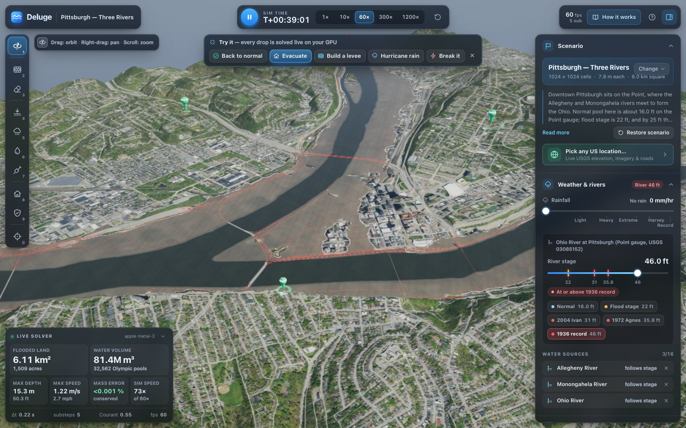
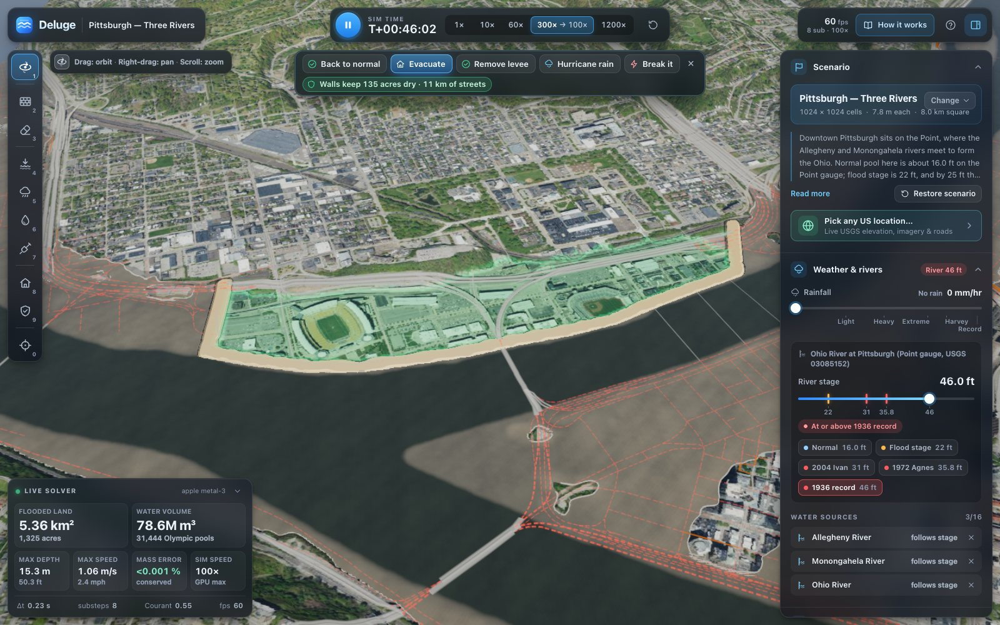

# Deluge — real-time flood simulation on real terrain



Deluge loads real elevation data — USGS 3DEP in the US, Copernicus GLO-30 elsewhere — and solves the 2-D
shallow-water equations on the GPU with WebGPU compute shaders, live in a browser tab. Raise the rivers to the 1936
crest, build a levee and see the land it keeps dry, crank the rain, and watch an evacuation route re-plan as roads go
under.

Beyond rising water:

* **Glacier hazards.** A rock-ice avalanche or a glacial-lake outburst high in the Himalaya, its breach hydrograph,
  the wave routed tens of kilometres down the valley past hydropower plants and towns, then the debris flood on the
  2-D map — on three real events (Nepal 2026, Sikkim 2023, Chamoli 2021), each run against what was observed.
  An early-warning designer shows how many minutes a sensor upstream would buy each town and plant.
  [Glacier hazards](#glacier-hazards) below.
* **What it costs, and what to do about it.** Damage and dollar loss per building, a parcel-level **Site check**
  for developers and lenders (depth, warning time, when the escape route closes, indicative floor height, what a
  wall or a raised floor would save), portfolio CSVs, expected annual loss and benefit–cost ratios.
* **How sure it is.** Flood-probability maps from a GPU ensemble of perturbed runs, and **future climate** (2050 /
  2080 / 2100 rain, sea level and glacial-lake growth).

Built for SteelHacks, *No Wrapper* track: no language models anywhere in the product. How it works in depth:
[ARCHITECTURE.md](ARCHITECTURE.md). Module contracts: [src/contracts.ts](src/contracts.ts). The business case — site
due diligence, portfolios, glacier risk for hydropower, with worked numbers from the app — is in
[BUSINESS.md](BUSINESS.md).

## Run it — three ways

Needs Node 20.19+ or 22.12+. The two browser paths need a WebGPU browser: Chrome, Edge or Brave 113+, Safari 26+
(Safari 18 has WebGPU behind *Develop → Feature Flags*), or Firefox 141+ on Windows / 147+ on Apple-silicon Macs. All
four built-in scenarios run with no network at all; only live areas and the location picker use the internet.

```bash
npm ci                        # the only step that needs the network
```

**1 · Dev server** — hot reload and `window.__deluge` in the console:

```bash
npm run dev                   # http://localhost:5173
```

**2 · `npm run demo`** — the production build, served locally. This is the offline demo path:

```bash
npm run demo                  # builds, then serves http://localhost:4173
npm run demo -- --port 5000   # if 4173 is busy
```

**3 · `Deluge.app`** — a macOS desktop build, for presenting without a terminal or a browser on screen:

```bash
npm run app:build             # typecheck, build, package → release/Deluge.app (ad-hoc signed, ~330 MB)
open release/Deluge.app
npm run app:dev               # the wrapper on the current build, without packaging
```

The wrapper (`electron/`) is an Electron main process with no preload, no IPC, no Node in the renderer and no
listening port. It serves the same static build over a privileged `app://deluge/` origin, sends the CSP —
`frame-ancestors 'none'` included, which a hosted copy cannot — as real response headers, allows network requests
only to the seven data endpoints, denies every permission the page could ask for, and holds the display awake from
the main process, so the venue screen cannot sleep mid-pitch even on a Mac whose browser has no Wake Lock API.
`npm run app:check` is its release gate; the app is not committed (`release/` is ignored), so build it on the
machine that will present.

In a browser, Deluge asks for a **Screen Wake Lock** instead, which holds the display awake in Chrome and Brave with
nothing to switch on. Safari has no such API — see [DEMO.md](DEMO.md) for the `caffeinate -dis` fallback.

Presenting to judges? [DEMO.md](DEMO.md) has the pre-demo checklist, pitch scripts and a Q&A crib sheet.

`npm run build` writes a static site to `dist/` with relative URLs, so any static host works, including under a
sub-path (`.github/workflows/pages.yml` publishes it to GitHub Pages once the repository is public and Pages is set to
"GitHub Actions"). A hosted copy still needs WebGPU; keep `npm run demo` as the offline path.

URL options: `?preset=pittsburgh|johnstown|ellicott|asheville|nashville|houston|boulder|sandbox` (the full list is
under *Scenario → Change*, and in [Ten scenarios, offline](#ten-scenarios-offline) below), or any US area with
`?live=<lat>,<lon>,<km>`
(e.g. `?live=29.95,-90.07,6` for New Orleans; this needs the internet for USGS, Esri and Census TIGERweb).
`?usecase=site|glacier|portfolio` opens one of the business use cases below, set up with its demo data.

## Try this (30 seconds)

1. Pittsburgh loads with full rivers. Click **Raise to 1936 record** in the *Try it* strip. The rivers rise to 46 ft
   along their whole length over a few simulated minutes (a time-lapse: the real 1936 rise took ~30 hours), and the
   Point, the North Shore and the Strip District go under.
2. Click **Evacuate** (or press **8** and click a street): the route to the nearest dry shelter re-plans, or turns red,
   as roads flood.
3. Click **Build a levee**: a floodwall goes up along the North Shore and the 1936 rise replays with it in place. The
   land it keeps dry turns green and the strip counts it (about 139 acres and 11 km of streets at the crest), while
   the evacuation route re-plans as the water comes back. Or press **2** and drag your own wall, tying both ends into
   high ground; press **V** to step through Depth / Max depth / Speed / Arrival (minutes until the water came) /
   Hazard (AIDR H1–H6 classes from depth × speed), or scroll the side panel to View.



On a live area with no river crossing the map edge (picked with *Pick any US location*), the first button drops a
thunderstorm over the view instead.

Keys: `1`–`0` tools, `Space` pause, `R` reset water, `V` next water view, `?` help. **On a laptop,** plug in: the app
adapts solver substeps and render resolution to measured frame time and GPU latency, and detects browser 30 fps caps on
battery, but 60 fps needs mains power. On an Apple M4 the 1936 crest flood with extreme rain runs at 60 fps (p95 frame 19 ms) and
~70× real time at 1600×1000 (numbers and the MacBook Air expectation: [ARCHITECTURE.md §8.1](ARCHITECTURE.md#81-performance-budget-measured)).

## Impact & loss

The side panel's **Impact & loss** section (collapsed; nothing in it runs until asked) turns the flood on screen into
what it does to the buildings under it: buildings reached, damaged and destroyed, an estimated dollar loss with its
range, AIDR H1–H6 hazard classes, the first arrival at a building, and buildings whose access road went under. It
reads the solver's per-cell maxima (`FloodSolver.readHazardFields`); a solver without them gets a depth-only fallback
that says so. Damage comes from the JRC global depth–damage curves (Huizinga et al. 2017) applied storey by storey,
values from footprint area × storeys × a per-country unit cost (US, India, Nepal; 2026 USD), and fast water from the
Clausen & Clark depth × velocity thresholds. **Set as baseline**, build a wall, replay and recompute for avoided loss,
buildings the wall makes wetter, wall cost and a single-event benefit–cost ratio at 7 % and 3.1 %. A sites / portfolio
CSV (`asset_id, lat, lon` or a WKT polygon, plus optional values, floors, revenue …) is parsed in the tab — never
uploaded — and exported results come as a CSV or a print-ready report with the methods and sources. Everything
behind it is pure TypeScript in [`src/loss`](src/loss), every assumption a named constant with its source, tested in
`tests/loss`.

**Site check** (the panel section of the same name, and the Site tool, `S`) is the due-diligence view of one parcel:
click to drop a site or drag around the parcel to outline it, describe the planned building (use, floors, value,
first-floor height, critical equipment), and it reports depth at grade and above the planned floor, speed, AIDR class,
arrival and time under water, damage and loss, and **egress** — when the last road route from the site to a shelter
closes, against when the water arrives (the evacuation router over the flood rebuilt from the run's arrival times).
**Run sweep** replays the scenario headless at full speed for a ladder of levels — NWS flood categories, FEMA / NOAA
1 %-type levels and historic crests for Pittsburgh, Nashville and Fort Myers, each with its source
([src/loss/ladders.ts](src/loss/ladders.ts)), or multiples of the rain and inflows elsewhere — then puts the user's
scenario back and adds EAL with a loss-exceedance chart, an indicative finished-floor elevation (design water + ASCE
24-14 freeboard), wall / levee / elevation / dry-floodproofing options with BCR, and a verdict in plain sentences. Return
periods are only filled in where published; the rest are the user's input and labelled so. Sites stay in the tab
(**Share link** writes them to `?sites=` on request) and export as a print / HTML "Site assessment". On Pittsburgh, a
3-storey office pinned at the Point (40.4425, −80.0085) stays dry up to the 2004 Ivan crest, takes 0.98 m at FEMA's
1 % level (35.4 ft) and 4.5 m at the 1936 crest, and loses its last dry route to a shelter as the water arrives; the
indicative floor is 1.28 m above grade. Indicative screening, not engineering advice.

Every headless run (sweep levels, ensemble members, today-vs-future pairs) runs **exactly** the simulated time asked
— the solver lands on it with a short last substep instead of running on until a readback catches up (600 s used to
end anywhere in 614–706 s) — and repeats agree: the hazard maxima are sampled every 5 simulated seconds rather than
whenever a frame happened to render, and the river stage rises on a fixed simulated-time grid rather than in
frame-sized steps. The fast-water collapse rule reads the 90th percentile of the footprint's cells, not its single
worst one, and ramps from the depth curve to total loss across 5–9 m²/s (the cited 7 m²/s at its centre) — both
labelled heuristics. The North Shore demo parcel at the 1936 crest, whose damage used to flip between 15 % and
100 % from one sweep to the next, now reads 79–81 % ($39.2–40.1 M) across fourteen sweeps, and Houston's today-vs-2050 loss for the 100-yr level read $2.7 M → $3.2 M in four of four repeats (the change used to come out anywhere from −30 % to +18 %). Choosing a design event other
than the 1 % level says so, and what the 1 % level that was also run gives at the site.

**Uncertainty** (its own panel section) turns "this street floods" into "this street floods in 9 of 12 plausible
versions of this event". It re-runs the scenario on screen N times (12 by default, 3–32) headless at full speed — the
Site check machinery: render hold, progress with an ETA, Cancel, your scenario put back afterwards — with its
uncertain inputs nudged within stated bands, drawn by Latin hypercube from a seed (the same seed gives the same
members): inflow ± 20 % (on a glacier-chain preset, the chain's own ensemble members instead), rain ± 25 %, river
stage ± 0.3 m, Manning n 0.025–0.05 log-uniform, and the terrain itself — a smooth random bed error of σ 0.2 m on
USGS 3DEP, 2.5 m on Copernicus GLO-30, zero under the water that was there at the start so the rivers stay at rest.
Each member's max depth is folded into a per-cell tally on the GPU (no full-grid readback for the map), and one
hazard readback per member feeds the loss model. Out come a **Flood probability** water view (share of members
deeper than 15 cm, or 50 cm: < 10 / 10–30 / 30–50 / 50–70 / 70–90 / > 90 %, drawn on the deepest water any member
reached), flooded area, buildings reached and loss as p10 / p50 / p90, and per Site check site and portfolio asset
"floods in k of N members" (also on the Site check card). On the GTX 1660 Ti here, 12 members × 30 simulated minutes
took 48 s at the 1936 Pittsburgh crest and 58 s for Houston under Harvey's rain — **12–15 members a minute** (8–10 on a
cold first run). Read it for what it is: **sensitivity to the stated input bands, not a calibrated probability of the
real event** — every band is a labelled assumption, members are equally weighted, and everything the model leaves out
(drains, buildings, bathymetry) is the same in every member, so the real uncertainty is wider. Details:
[ARCHITECTURE.md §3.10](ARCHITECTURE.md#310-ensembles-flood-probability-under-stated-input-uncertainty).

**Use cases** (top bar, or *For business* in the Try-it strip; `?usecase=` links) set the three business questions
up in one click: *check a site before you build* (Pittsburgh, two demo parcels in Site check — a North Shore lot and
one on the higher ground of Allegheny Center), *glacier risk for hydropower* (Nepal 2026, the hazard chain and its
early-warning designer) and *portfolio exposure* (Houston under Harvey's rain, with a demo portfolio loaded into Impact
& loss). The same dialog has a printable one-page brief of what the app computes for a business and where those
numbers stop. The demo portfolio, [public/demo/houston-portfolio.csv](public/demo/houston-portfolio.csv), is
**fictional**: 19 made-up assets named "Demo …" and tagged `fictional-demo`, pinned to real building footprints with
invented values (the CSV reader has no comment rows, so the note lives here). Worked numbers from all three:
[BUSINESS.md §4](BUSINESS.md#4-three-worked-stories-with-the-apps-own-numbers).

On the 1936 crest (30 simulated minutes, depth-only fallback) the panel books about 1,330 of Pittsburgh's 45,000
buildings reached and **$5.5 B** (±1σ curve range $3.8–7.0 B); the one-click levee avoids about $1.0 B of it. These
are screening numbers for one simulated event on bare-earth terrain: not a flood study, not an insurance valuation,
not a catastrophe model, and the real uncertainty is wider than the band (values, terrain, missing drains).

## Glacier hazards

Three Himalayan scenarios start their flood upstream of the map, in a **hazard chain** (`src/hazard/`, design in
[docs/research/glacier-hazard-chain.md](docs/research/glacier-hazard-chain.md)): a source (lake volume from its area,
a moraine breach eroding at a set rate, or a rock-ice avalanche and the ice it melts) → its outflow hydrograph → a
1-D routing of the wave down a valley profile baked from the DEM (`chain.json`: 32–73 km of thalweg and
cross-sections, with hydropower plants, towns and gauges on it) → the routed hydrograph enters the 2-D map as an
inflow that delivers exactly its volume → the 2-D solver runs it with a **debris-flow rheology** (O'Brien–Julien,
Voellmy or Bingham, ARCHITECTURE.md §3.9) and a 25 m/s speed cap. The chain runs in a Web Worker in about a second,
plus a 27-member ensemble for p10–p90 bands; each preset also ships the calibrated run it was baked with.

The **valley timeline** under the map shows the profile, the front moving down it in step with the simulation clock,
each station lighting up as it passes with its modelled and observed arrival in the event's own clock ("09:46 NPT"),
and the hydrograph at the source and at the map edge. The **Early warning** designer places sensors on that profile
(gauge, trip-wire, camera, seismic; detection and alert latencies) and gives each town and plant its lead time, the
best single sensor site, and the lead time against sensor position. `?usecase=glacier` opens it on Nepal.

| Scenario | Event | Model vs observed (median run) |
| --- | --- | --- |
| **Betrawati — Trishuli** (`nepal`) | 26 Aug 2026: Langtang Lirung rock-ice avalanche → Bhote Koshi → Trishuli; ~20 Mm³ of excess water, the Betrawati bridge lost | front at Betrawati **70 min** after the avalanche vs **43 min** reported — the model is late |
| **Chungthang — Teesta** (`chungthang`) | 3–4 Oct 2023: South Lhonak lake outburst, 68 km upstream; the 1,200 MW Teesta-III dam destroyed | front at Chungthang **109 min** vs **~137 min**; peak **~9,600–9,800 m³/s** vs 7,355–14,673 reconstructed |
| **Raini–Tapovan** (`chamoli`) | 7 Feb 2021: Ronti peak collapse → debris flow; Rishiganga (13.2 MW) and Tapovan-Vishnugad (520 MW) plants hit | peak at Raini **~10,900 m³/s** vs 8,200–14,200; front at the Tapovan barrage **21 min** vs **~15 min** |

These are honest residuals, not fits: the calibration changed physics (trigger mechanism, a smoothed bed, a minimum
channel width, the avalanche's own travel time, Ferguson's boulder-bed resistance law with a literature grain size)
and refused to tune Manning n to the clock. The model is late in Nepal and Chamoli and early at Chungthang, so no
single resistance setting explains both; the likelier causes are the sources and the 30 m radar DEM's gorge sections.
Every scenario's on-screen text gives its own error. Lead times from the designer are therefore best read as
differences between sensor designs, not absolute minutes.

## Future climate

Anyone building or lending for 30–50 years gets asked what the site looks like in 2050 or 2080 (IFRS S2 scenario
analysis, lender questionnaires). **Weather & rivers → Future climate** picks a horizon — Today, 2050, 2080, 2100 — and
a pathway — SSP2-4.5 (middle of the road) or SSP5-8.5 (high) — and scales this scene's *forcing*; the solver then
makes the flood:

* **Rain and storm cells** × (1 + α)^ΔT, with ΔT the global warming since 1995–2014 from IPCC AR6 Table SPM.1 and α =
  7 %/°C (Clausius–Clapeyron, AR6's figure for daily extremes) or 10 / 14 %/°C (the observed super-CC band for hourly
  bursts). 2050 SSP5-8.5 at 7 %: ΔT 1.55 °C, rain × 1.11 (Harvey's 173 mm/hr → 192); 2100 SSP5-8.5: × 1.27.
* **Rain-fed inflows** × the same factor; a dam-break surge (Johnstown 1889) and a hazard-chain wave are left alone.
* **Sea level** at Fort Myers: + NOAA 2022 relative rise at gauge 8725520 (SSP2-4.5 → Intermediate-Low 0.28 / 0.49 /
  0.62 m, SSP5-8.5 → Intermediate 0.32 / 0.70 / 1.10 m in 2050 / 2080 / 2100), on top of the stage slider.
* **River stages** (Pittsburgh, Nashville) are not scaled — a stage is the hydraulics' answer, not a forcing.
* **Glacial lakes**: South Lhonak's area grows with warming along its 2008–2023 trend (capped at 2×), its volume
  follows from the chain's V–A relations, and the hazard chain re-runs with it.

It is a layer on what the solver receives: the rain slider, the inflow list and the stage slider keep showing
today's values, and the block lists every modified number with its source. In **Site check**, **Today vs future**
runs the ladder twice and reports "EAL today $X → 2050 · SSP5-8.5 $Y" with per-level losses, in the panel and the
report (return periods stay today's). Both runs of a level are exactly as long as asked, so the difference is the
climate, not run length. Forcing-scaled, not downscaled projections; method, sources and gaps in
[docs/research/climate-scenarios.md](docs/research/climate-scenarios.md), code in [`src/climate`](src/climate).

## Batch / API

The same simulator without the browser, for portfolios, sweeps and scheduled jobs: `deluge` is a Node CLI
([`src/cli`](src/cli), launched by [`bin/deluge.mjs`](bin/deluge.mjs)) that runs the app's own TypeScript — solver,
scenario wiring, loss model — on the machine's GPU through Dawn (the `webgpu` package the GPU tests use: D3D12 on
Windows, Metal on macOS, Vulkan on Linux). Offline, nothing uploaded. After `npm ci`:

```bash
npx deluge presets --levels                       # the ten scenarios and their Site check levels (no GPU)
npx deluge run --preset houston --minutes 60 --rain 173 --out results/harvey
npx deluge run --preset pittsburgh --stage-ft 46 --out results/1936
npx deluge run --preset houston --climate 2050:ssp585 --out results/houston-2050
npx deluge portfolio --preset houston --csv public/demo/houston-portfolio.csv --minutes 60 --out results.csv
npx deluge portfolio --preset houston --csv assets.csv --members 12 --seed 7 --out results.csv --summary summary.json
npx deluge site --preset pittsburgh --at 40.4425,-80.0085 --use office --floors 3 --sweep --out report.json
npx deluge <command> --help                       # every option
```

(`npm run deluge -- …` works too.) Scenario options are shared: `--minutes` (default 30, as in the app), `--stage-ft`
(a gauge reading, as on the slider), `--rain` (mm/hr), `--scale k` (rain, storm cells and inflows × k), `--manning`,
`--climate 2050|2080|2100:ssp245|ssp585[:cc|super10|super14]`, and `--scenario <level>` for a rung of the preset's Site
check ladder (`rp100`, `record1936`, `x0.5` …).

* **`run`** writes four GeoTIFFs and `summary.json`. The rasters are the solver's hazard fields
  (`FloodSolver.readHazardFields`), single band, in **EPSG:3857** with the tie point on the grid's outer north-west
  corner — the grid is linear in Web Mercator ([src/contracts.ts](src/contracts.ts) `GeoBounds`), so QGIS / GDAL place
  them exactly: `max_depth_m.tif` and `max_speed_ms.tif` (Float32), `arrival_min.tif` (minutes until water first stood
  > 0.15 m on land dry at the start; nodata −9999), `hazard_aidr.tif` (AIDR H1–H6 on flooded land, UInt8, 0 = none).
  The summary has the scenario as run (stage levels, rain, climate multipliers, the hazard chain's routed peak),
  flooded area, area per hazard class, the mass ledger, buildings reached / damaged / destroyed and the dollar loss.
* **`portfolio`** reads the in-app portfolio CSV (`asset_id`, `lat`/`lon` or `wkt`, values, floors, revenue, policy
  terms …) and writes the **in-app export's columns** cell for cell — depth, speed, AIDR and FD2321 class, arrival,
  damage, loss with its ±1σ range, downtime, BI, insured loss, access road — plus an `outside` row for any asset off
  the map. `--members N` adds the Uncertainty panel's ensemble (Latin hypercube from `--seed`, the same bands, the
  terrain-error field): `ens_reached_members` ("floods in k of N"), depth and loss p10 / p50 / p90.
* **`site`** is the Site check card: for the scenario, or with `--sweep` across the ladder the app ticks by default
  (`--levels` to choose, `--rp x0.5=10,x1=100` for return periods the ladder lacks), with egress, EAL, the
  loss-exceedance points, the indicative finished-floor elevation, mitigation options with BCR and the verdict
  sentences.

**Same numbers as the browser.** A run is the app's headless run: the store, `SimSync`, the stage ramp, the crest fill
and the climate layer are the app's own classes; frames advance 1/60 s at 3600× and stop exactly on the target,
hazard maxima are sampled every 5 simulated seconds; the loss calls are the panels' calls. The one deliberate
difference is when the GPU is read back — every 60 *simulated* seconds instead of every 300 ms of wall clock — which
makes a CLI run **bit-identical when repeated** on the same machine, where two browser runs agree to millimetres
([§ Impact & loss](#impact--loss)); `--app-cadence` restores the browser's cadence. Checked two ways:
`tests/cli/parity.test.ts` feeds the commands and the loss module the same fields and compares the CSV and the report
cell for cell, and `tests/cli/smoke.test.ts` (GPU) reproduces the binary's portfolio CSV from an in-process run and
runs a sweep twice. Against the app's own published numbers: the 60-minute Harvey portfolio gives 14 of 19 assets
reached, **$17.1 M** (±1σ $8.8–25.9 M), insured $23.5 M (BUSINESS.md §4.2 has 14–15, $17.2–17.3 M, $23.6 M); the
Point office sweep gives 1.03 m at the FEMA 1 % level and 4.50 m at the 1936 crest, an indicative floor 1.33 m above
grade (the panel: 0.98 m, 4.5 m, 1.28 m).

**Speed on the GTX 1660 Ti here** (1024² grids, 2–6 s of the total is loading the preset): Pittsburgh at the 1936
crest, 30 simulated minutes in 4.5 s; Houston under Harvey's rain, 60 minutes in 13 s; the seven-level Point sweep in
48 s. Those are with the GPU to itself; with other GPU jobs on the machine the same runs took 2–4× longer.

Progress and notes go to stderr, results to files or stdout (`--out -`). Exit codes: 0 done, 1 the simulation or an
output failed, 2 bad arguments or input file (checked before the GPU starts), 3 no WebGPU adapter. Turning this into
an HTTP service is the next step; the OpenAPI shape is sketched in [docs/api.md](docs/api.md).

## Ten scenarios, offline

Every scene is baked into the repo and needs no network. The seven US cities in the table below have real USGS
elevation, real NAIP photography, real Census streets, and a scenario built from that city's own gauge records (sources and licences:
[public/presets/SOURCES.txt](public/presets/SOURCES.txt)). Load time, frame rate and sim speed are measured in the
production build at 1470x956 DPR 2 on the demo MacBook Air M4, offline, with the scene's own camera and forcing —
one fresh browser context per scene, on a machine that was in Low Power Mode and sharing its GPU, so read them as an
upper bound on load time and a lower bound on speed. Sim speed is how many simulated seconds each wall-clock second
buys while the flood plays; it swings ±10 % run to run.

| Scene | Flood | Domain / cell | Photo | Streets | Cold load | fps | Sim speed |
| --- | --- | --- | --- | --- | --- | --- | --- |
| **Pittsburgh — Three Rivers** | 1936 St Patrick's Day crest, 46 ft | 8.0 km / 7.81 m | 1.95 m/texel + 3.0 km inset at 0.73 | 11,053 | 744 ms | 60 | ~100× |
| **Johnstown — Conemaugh Valley** | 1889 South Fork Dam flood as a 3,730 m³/s inflow | 7.0 km / 6.84 m | 1.71 + 2.5 km inset at 0.61 | 4,903 | 687 ms | 60 | ~82× |
| **Ellicott City — Main Street** | 2016 flash-flood storm over the Tiber branch | 5.0 km / 4.88 m | 1.22 m/texel | 1,224 | 606 ms | 60 | ~53× |
| **Asheville — French Broad Valley** | Hurricane Helene, 27 Sep 2024: record crests on two rivers | 8.0 km / 7.81 m | 1.95 + 3.0 km inset at 0.73 | 3,556 | 705 ms | 60 | ~125× |
| **Nashville — Cumberland River** | May 2010 flood; the slider also holds 1937 and the 1927 record | 6.0 km / 5.86 m | 1.46 m/texel | 5,410 | 686 ms | 60 | ~85× |
| **Houston — Buffalo Bayou** | Hurricane Harvey, Aug 2017: 173 mm/hr over a dead-flat plain | 8.0 km / 7.81 m | 1.95 + 3.0 km inset at 0.73 | 10,529 | 691 ms | 60 | ~63× |
| **Boulder — Canyon Mouth** | 2013 Front Range flash flood out of Boulder Canyon | 5.0 km / 4.88 m | 1.22 m/texel | 1,749 | 636 ms | 60 | ~48× |

Also baked, and not in the M4 measurements above: **Fort Myers — Caloosahatchee** (Hurricane Ian's 2022 storm surge
up a tidal river, 8.0 km / 7.81 m), and the three Himalayan glacier scenarios of [Glacier hazards](#glacier-hazards)
— **Betrawati** and **Chungthang** (8.0 km / 7.81 m) and **Raini–Tapovan** (12.0 km / 11.72 m) — built from Copernicus
GLO-30 radar elevation through a bare-earth filter, OpenStreetMap roads and buildings, and no aerial photograph (each
licence is in SOURCES.txt). Plus a procedural **sandbox** (river town, reservoir and dam) that uses no external data
at all.

**The close-up inset.** Four of the domains are wide enough that a single 4096² photo lands at ~1.7–2.0 m/texel, which
is mush at street level — so those four carry a second 4096² NAIP photo over the middle 2.5–3.0 km, blended into the
base in the terrain shader with an 8-cell feather. It buys 2.4–2.7× the texel density exactly where the scenario
cameras fly, costs 89.5 MB of GPU memory and 3.5–5.1 MB on disk each, and measures free on both load (−23 ms,
interleaved A/B) and frame time (deltas inside sample noise, one of them negative). The other three domains are
already at 1.22–1.46 m/texel, close enough to NAIP's own ~1 m limit that an inset would add megabytes and no detail.
`public/presets` totals 120.1 MB across eleven presets against a 125 MB static-host budget enforced by
`tests/data/presets.test.ts`. A visitor never downloads that number — presets load one at a time, so the cost is the
largest single preset (Asheville, 17.0 MB), which a separate 25 MB per-preset cap holds down; the directory total is
a host-and-repo budget, and the rationale for where it sits is in
[ARCHITECTURE.md §5](ARCHITECTURE.md#5-data).

## Why this is hard

An explicit shallow-water solver on real terrain wants to explode: rivers are deep and fast, floodplains are
centimetre-thin films, walls and streets are one cell wide, and everything runs in Float32 on a GPU in parallel.
Four ingredients keep Deluge stable, exact and fast (details in [ARCHITECTURE.md §3](ARCHITECTURE.md#3-numerical-method)):

1. **CFL-adaptive timestep with the 2-D Courant number** `dt = Cr·dx / (√2·max(√(g·h) + |u|))`, from asynchronous
   readbacks inflated by what is known to be coming. A wave never jumps more than a cell.
2. **Semi-implicit friction:** dividing instead of subtracting, so friction on thin films can only slow water down.
3. **Positivity-preserving flux limiter:** a cell can't give away more water than it holds, so depth stays ≥ 0 without
   clamping. A per-cell ledger books every change to the water — even the GPU's own Float32 rounding — so the HUD's
   mass-balance error stays ≈ 10⁻⁷ after hours of a crest with hurricane rain.
4. **Well-balanced face depths:** a lake at rest on steep, rough terrain stays at rest.

On top of that: minmod-limited θ-smoothing that damps grid-scale noise but not flow along staircase banks, open
boundaries that let rivers leave at their own depth, water-level boundaries that hold no momentum, and a river stage
that rises in simulated time instead of dam-breaking along every bank.

### Validation

From `npm test` (the solver tests run on a real GPU through Dawn); the grid-convergence rows from
`npx tsx scripts/reference-run.ts`, also on the real GPU:

| Check | Result |
| --- | --- |
| Lake at rest on rough terrain, 2000 steps ([wellbalanced](tests/sim/wellbalanced.test.ts)) | max \|u\| = 9.3·10⁻⁵ m/s |
| Dam break vs the Ritter analytic solution ([dambreak](tests/sim/dambreak.test.ts)) | profile error 1.6 % (L1) |
| Closed domain mass conservation ([conservation](tests/sim/conservation.test.ts)) | mass error 7·10⁻⁹ (volume change 2.5·10⁻⁶, all booked rounding) |
| Open domain with rain, storms, inflow, stage, infiltration ([conservation](tests/sim/conservation.test.ts)) | mass error ≤ 9.1·10⁻⁸ |
| Deep river with rain and a stage boundary, 3 sim-hours ([conservation](tests/sim/conservation.test.ts)) | mass error 5.9·10⁻⁷ |
| Rain on a tilted plane at steady state ([boundary](tests/sim/boundary.test.ts)) | outflow / rain = 1.000 |
| Channels at 0–60° to the grid ([channel](tests/sim/channel.test.ts)) | depth within 6 % of Manning's normal depth (0.98–1.05) |
| GPU (Float32, parallel) vs Float64 CPU reference, 5 cases × 400 steps ([reference](tests/sim/reference.test.ts)) | max \|Δh\| ≤ 4.3·10⁻⁵ m |
| Grid convergence, 1936 crest: the 1024² demo grid vs a 4096² run of the same solver, 16× the cells, 30 sim-min ([reference-run](scripts/reference-run.ts)) | flooded area −0.92 %, flood-extent IoU 98.0 %, max-depth RMSE 0.29 m (median 6 cm), landmark arrivals within 2.2 % |
| The same under 100 mm/hr rain ([reference-run](scripts/reference-run.ts)) | flooded area −0.55 %, flood-extent IoU 78.2 %, max-depth RMSE 0.22 m (median 5 cm) |
| All seven baked cities in the production build, offline, at 1470x956 DPR 2 ([e2e](scripts/e2e.mjs) flow 7, [presets](tests/data/presets.test.ts)) | load 606–744 ms, 58.7–60 fps, sim 48–134× real time, mass error ≤ 6·10⁻⁸, no console or WebGPU errors, zero network requests |
| Every scene's streets, shelters and evacuation routing ([e2e](scripts/e2e.mjs) flow 5) | 1,224–11,053 road edges, 4–5 shelters, a route plans dry and re-plans as streets flood, on all seven |

In the running app the HUD's mass-balance error stays below 0.001 % at the 1936 crest, with or without hurricane rain.

**The flood is not an artefact of the cell size.** The same solver on the same scenario at 7.81, 3.91 and 1.95 m cells
(34 minutes of GPU time on this laptop — the 4096² reference run needed no rented GPU) agrees to about 1 % in flooded
area, and halving the cell size halves the error. It converges *less* well where you would expect: rain puts water in
noticeably different places at 7.8 m (78 % overlap against the reference, against 98 % for the river crest), the worst
1 % of flooded cells differ by more than 1.3 m — those are flood-margin and street-width flow paths — and the area with
*any* water (1 cm) under rain does not converge at all. What this does and does not prove, in detail:
[ARCHITECTURE.md §9.1](ARCHITECTURE.md#91-grid-convergence-the-demo-grid-against-a-16-finer-reference). Short version:
it bounds the solver's discretisation error; it says nothing about whether a 7.8 m bare-earth DEM is the right terrain,
and nothing about accuracy against the real flood.

**Checked against the National Weather Service.** NWS impact statements for the Point gauge (PTTP1), against Deluge
holding each stage for 15 simulated minutes:

| NWS impact | NWS stage | Deluge |
| --- | --- | --- |
| Point State Park flooded to the Portal Bridge | 30 ft | dry at 30 ft, wet at 31 ft |
| PNC Park field flooded | 31 ft | dry at 31 ft, 1 m deep at 35 ft |
| Federal Street at PNC Park flooded | 40 ft | dry at 36 ft, wet at 40 ft |
| Up to 15 ft of water in the Golden Triangle | 46 ft | 15.7 ft at Point State Park |
| Acrisure Stadium field; Station Square tracks | 30 ft; 31 ft | first wet at 40 ft (both) |
| Wood Street T station; Parkway "bathtub"; Fort Pitt Blvd | 28; 25; 28 ft | wet only at 46 ft; dry at 46 ft; dry at 46 ft |

The water surface at the Point stays within 3 cm of the gauge reading at every stage. River-level and open-ground
impacts match within a few feet; the misses flood through what bare-earth elevation doesn't contain (storm drains,
underpasses, depressed roadways, underground stations). Full table: [ARCHITECTURE.md §4](ARCHITECTURE.md#4-rivers-stages-and-crests).

## How a frame works

```
solver.step ─▶ N substeps in one compute pass:  momentum pass ─▶ continuity pass   (CFL dt each)
renderer    ─▶ (every other frame) export pass (h, u, v, max depth; hazard accumulators) + prep ──▶ MSAA HDR → ACES
every ~300 ms, never blocking: stats reduction pass ─▶ mapAsync ─▶ HUD + road flood status ─▶ evacuation route
```

| Module | |
| --- | --- |
| [`src/sim`](src/sim) | GPU solver (WGSL in `shaders/`), forcing, brush edits, Float64 CPU reference |
| [`src/render`](src/render) | terrain LOD, water, hazard maps, walls, roads/route ribbons, camera, picking |
| [`src/data`](src/data) | USGS 3DEP / imagery / roads loaders, hydro-conditioning, presets, live areas |
| [`src/routing`](src/routing) | road graph, flood status per edge, travel-time Dijkstra |
| [`src/loss`](src/loss) | impact & loss: damage curves, values, hazard classes, access loss, sites/portfolio CSV, EAL/BCR, site check (egress timing, event ladders, FFE, verdict), ensemble sampling and aggregation (pure, no DOM) |
| [`src/climate`](src/climate) | future-climate tables (AR6 warming, rain scaling, NOAA sea level, lake growth) and the forcing transforms (pure, no DOM) |
| [`src/ui`](src/ui) | panels, tools, HUD, How it works, location picker |
| [`src/app`](src/app) | scene loading, store → solver sync, stage ramp, protected-land analysis, frame pacing, screen wake lock, debug API (`window.__deluge`, dev and flagged builds only) |

## Repo tour

* `src/<module>/` — the app, one folder per module, integrated through [`src/contracts.ts`](src/contracts.ts).
* `tests/<module>/` — `node:test` suites (sim, render and the CLI smoke test on a real GPU through Dawn).
* `src/cli/`, `bin/deluge.mjs` — the headless batch CLI ([Batch / API](#batch--api)).
* `scripts/bake-presets.ts` — bakes `public/presets/*` (raw downloads cached in `artifacts/bake-cache`);
  `scripts/e2e.mjs` — end-to-end demo flows in headless Chromium on the real GPU; `scripts/bench.mjs` — the
  performance benchmark (`npm run demo`, then `npm run bench -- --scenario=pgh`); `scripts/shot.mjs` — screenshots.
* Dev harnesses (run `npm run dev`, then open): `dev/render.html` (the renderer on a synthetic valley with analytic
  mock water, or `?preset=<id>` with the real solver), `dev/sim.html` (solver), `dev/data.html` (data loaders),
  `dev/ui.html` (UI on a fake store), `tests/routing/harness.html` (routing).

## Testing

Deluge ships seven test layers. The first two are pure CPU and run anywhere; the rest drive a real GPU through
headless Chromium (or a real Electron build) and want a machine with WebGPU — the demo MacBook Air.

| Command | What it guards | Time |
| --- | --- | --- |
| `npm run typecheck` | TypeScript, no emit | ~5 s |
| `npm test` | 326 unit tests (solver, data, routing, UI, render helpers) | ~35 s |
| `npm run e2e` | 13 end-to-end app flows in a real browser (`-- --prod` for the built bundle) | ~4 min |
| `npm run test:perf` | **No lag** — fps, frame times, sim speed, input latency, drift | ~10 min |
| `npm run test:visual` | **No graphics glitches** — golden images + baseline-free detectors | ~20 min |
| `npm run test:security` | **No security regressions** — the penetration test's cases, automated | ~8 min |
| `npm run app:check` | **The desktop build** — 43 checks against a packaged, fused `Deluge.app` | ~12 min |

On a machine that has never run them, install the browser once with `npx playwright install chromium` (Playwright
itself is already a devDependency; the suites need its bundled Chromium for WebGPU). `npm run test:unit` is the
subset of `npm test` that needs no GPU; `npm run test:all` is everything at full length.

Each of the three suites builds its own production bundle, serves it on its own port (5701/5702/5703), writes a JSON
report under `artifacts/`, prints a table and exits non-zero on a regression. All take `--quick` for a fast subset,
and `--url=<url>` to measure an already-running or hosted copy instead. `npm run test:suites` runs all three in quick
mode and is the recommended pre-demo gate.

Those times assume a quiet machine on AC power with Low Power Mode off. Everything here is GPU work: with Low Power
Mode on, a background Spotlight reindex, or another browser open, the same runs take two to three times longer — and
the perf numbers stop meaning anything (see below).

```sh
npm run test:suites                     # fast gate, all three
npm run test:perf -- --quick            # one suite, fast
npm run test:visual -- --scene=bridge  # one scene
npm run test:security -- --case=CAP     # one group of cases
```

### `npm run test:perf` — the lag suite

Six scenarios (idle Pittsburgh, crest raise, crest + 100 mm/hr rain at 300×, Johnstown inflow, a levee built with
real pointer drags, and a live-area load that is skipped when offline) at both the demo viewport (1470×956 @ DPR 2)
and 1600×1000 @ DPR 1. Per scenario it asserts mean and p95-low fps, frame-time p50/p95/p99, the count of frames over
34 ms and 50 ms, achieved sim speed (absolute and as a fraction of what was asked), main-thread CPU ms per frame, GPU
queue latency, input latency (a real pointer drag, measured to the first frame that shows the new camera),
time-to-interactive, and — once — a 60-second sustain run checked for drift.

Thresholds come in two tiers. **Floors** are "the demo is visibly broken" and are always fatal. **Targets** are what
this machine actually measures today plus headroom; they are fatal on a quiet machine and advisory when the run is
noisy. Every threshold is overridable: `DELUGE_PERF_MIN_FPS=50 npm run test:perf`.

The suite records `pmset` power state and the busy processes with every run. **Low Power Mode changes the answer**:
on the demo Air the same scenario measured 162× sim speed with it off and 27× with it on. A run with Low Power Mode
on is therefore never fatal — it prints a banner telling you to turn it off and re-run. Plug in and turn Low Power
Mode off before believing any number here.

**Run this suite first, on a cool machine, not after the other two.** The Air is fanless. In the release run the
crest-and-rain scenario measured 44.6× and missed five *floors* after ~45 minutes of back-to-back GPU suites with a
macOS background-sync storm running; the same scenario on the same build minutes later, on a quieter machine,
measured 152× and passed every threshold with margin. Same binary, 3.4× apart. If a run fails, look at the `load`
and `power` lines it printed before you go looking in the renderer.

### `npm run test:visual` — the graphics-glitch suite

Fourteen scenes are frozen into an exactly reproducible state through `window.__deluge` — sim paused, advanced by an
exact number of simulated seconds with `runFor`, camera pose assigned rather than animated, and the adaptive quality
ladder pinned so render scale cannot drift — then captured at 1470×956 @ DPR 2. Scenes cover the default Pittsburgh
view, the 1936 crest, the demo levee with its protected-land glow, all three hazard modes, each other preset's own
camera, a close-up shoreline, a drawn wall, a bridge, top-down and a low grazing angle.
The two transient toasts are hidden for the capture — they auto-dismiss on a wall-clock timer, so whether one is on
screen depends on how long the machine took, which is worth ~3 % of the frame and nothing to do with rendering.

Two honest limits on what these goldens catch. **They have no scene for Asheville, Nashville, Houston or Boulder** —
those four are covered end to end by `npm run e2e` (flow 7 reads the city list off `public/presets`, so it cannot go
stale), not by a pixel baseline. And the goldens compare at **1/8 resolution** (`baselineShrink 8`), which is what
makes them robust to sub-pixel drift but also means they are **blind to imagery sharpness**: the close-up insets moved
them by nothing, and a future sharpness regression would not move them either. One scene is genuinely flaky —
`pittsburgh-velocity`, the only one comparing an instantaneous field rather than an accumulated one, measured 0.0051,
0.0163, 0.0215 and 0.0305 on four runs of identical code against a 0.02 threshold; see
[ARCHITECTURE.md §9](ARCHITECTURE.md#9-validation).

Two independent checks:

- **Golden images.** Each scene is compared with its committed baseline in `tests/visual/baselines/` using a
  perceptual (YIQ-weighted) diff; the tolerance is the fraction of pixels allowed to differ. When a rendering change
  is intentional, look at the diffs in `artifacts/visual/diff/`, then re-record with `node scripts/visual.mjs
  --update` and commit the updated PNGs.
- **Detectors that need no baseline** — the real regression net, because a stale baseline happily approves a glitch:
  black or blank frames, NaN-magenta pixels (the blown-up-cell sentinel colour, which nothing a user can do
  reaches — that it *is* painted for non-finite state is covered by `tests/render/prep.test.ts`), water standing
  unsupported above terrain (a hydrostatic check against the solver's own arrays), shoreline stair-stepping,
  z-fighting flicker (repeat captures of a frozen scene must be identical), missing aerial imagery, UI panels running
  off the canvas edges, and legend-vs-pixels colour agreement — the water mask is obtained by re-rendering the same
  frozen scene in another hazard mode, so the check needs no tuned colour threshold and fails if a mode is ever wired
  to the wrong ramp.

### `npm run test:security` — the security regression suite

This one builds the **released** bundle — a plain `vite build`, with no debug API — and drives it through the DOM
only, because one of the things it checks is that `window.__deluge` is not there. Every third-party host is
intercepted, so the run is hermetic and behaves identically offline.

It automates the findings of this project's own penetration test: link-parameter spoofing through `?name=`,
`?preset=` and an invalid `?live=` (the attacker's sentence must never appear in the app's chrome, and no bidi
control character may reach the DOM); XSS through hostile Nominatim results, preset metadata and road data
(`window.__pwned` must stay unset); the Content-Security-Policy present in the built `index.html`, restrictive, ahead
of the first script tag, and raising zero violations across the main flows; response byte caps refusing an oversized
body, a forged `Content-Length` and a gzip bomb without exhausting memory; no source maps, build-machine paths or
debug surfaces in `dist/`; and a clean `npm audit --omit=dev`. A case whose fix has not landed, or that could not be
exercised in this build, is reported **PENDING** rather than passing silently; `--strict` makes pending fatal.

### `npm run app:check` — the desktop build's release gate

`electron/verify-renderer.mjs` then `electron/verify-packaged.mjs`: 43 checks (23 + 20) over the wrapper's rules — no Node,
bridge or IPC in the renderer, the `app://deluge` origin and a real WebGPU adapter, the CSP on every response,
path-traversal attempts refused, navigation and new windows blocked, the network allowlist proven independently of
CSP, every permission denied, a self-signed data host rejected, the R11 fuse wire, a tampered `app.asar` refusing to
start, no listening socket, no DevTools, no debug API in the packaged asar, and the display-sleep blocker running.
The packaged, fused app cannot be driven from outside (that is two of the checks), so it reports on itself through a
hook that `electron/package.mjs` stages **only** into the differently-named verification bundle; the shipped
`Deluge.app` does not contain that code at all.

**Driving the app from automation.** The e2e flows, `scripts/bench.mjs` and `scripts/shot.mjs --ready=…` all steer the
app through `window.__deluge`, which a released build no longer contains: it is compiled out unless the build sets
`DELUGE_DEBUG_API=1` (`vite.config.ts`, `src/env.d.ts`), so a copy handed to anyone else exposes no automation surface.
`npm run dev` keeps it, and `npm run e2e` sets the variable before it builds, so neither needs anything. A server you
start yourself for those tools needs it too:

```bash
DELUGE_DEBUG_API=1 npm run demo   # same as npm run demo, plus window.__deluge for bench / shot
```

Routing timing bounds are asserted in `tests/routing/perf.test.ts` (normalised for machine load); `PERF=1` also checks
them in the real-data Pittsburgh test.

## Security

No accounts, no backend, no analytics and nothing stored: the app is static files plus the seven public data
endpoints it fetches terrain, imagery, roads and place names from. A released build contains no automation surface
(`window.__deluge` is compiled out), and its Content-Security-Policy is `default-src 'none'` with `script-src 'self'`
— no `unsafe-inline`, no `unsafe-eval` — restricting `connect-src` to exactly those seven endpoints
([`src/data/csp.ts`](src/data/csp.ts) is the single source of truth, mirrored into the desktop wrapper and guarded by
a test that fails if a new host appears). `npm run test:security` re-runs this project's own penetration-test cases
against the built bundle, and `npm run app:check` re-runs the desktop wrapper's — including that a renderer can
leave nothing behind (localStorage, IndexedDB, service workers, cache storage and the Origin Private File System
are cleared before the window opens) and that a packaged build refuses to start if its command line asks it to
drop TLS validation or the sandbox.

**Accepted risk, stated on purpose:** a copy hosted on GitHub Pages can be framed by any other origin. Pages cannot
send a `Content-Security-Policy` header and `frame-ancestors` is ignored in a `<meta>` tag, so there is no way to
forbid it from a static host. The impact is limited to what a framed copy could do: there is nothing to click-jack
into — no accounts, no state-changing requests, nothing persisted — so the worst case is a misleading presentation of
a simulation. `Deluge.app` serves the same build with `frame-ancestors 'none'` as a real header
([ARCHITECTURE.md §10](ARCHITECTURE.md#10-shipping-browser-desktop-app-and-the-test-suites)).

## Known limitations

* **Hydro-flattened elevation.** 3DEP has no river bathymetry, so channels are burned to a nominal depth (6 m for
  Pittsburgh's rivers); river volumes and speeds are approximate.
* **Bare-earth terrain.** Buildings, bridge decks and culverts are not in the DEM; water flows through blocks and under
  viaducts, and storm drains are not modelled. Road and highway embankments therefore dam small creeks: under heavy
  rain water ponds several metres deep behind them (8.5 m behind I-376 in Pittsburgh's Saw Mill Run valley at
  100 mm/hr; up to 14 m in a pit beside US 40 after an hour of Ellicott City's storm), which also sets the HUD's max
  depth.
* **Uniform roughness.** One Manning's n for the whole map (0.035, adjustable under Advanced); no land-cover roughness
  map.
* **Protected land is a still-water estimate.** The green "kept dry" land and its acres compare the water level held
  back by the walls with and without them; they ignore how long water leaking through a gap would take to fill the
  land behind it.
* **Time-lapse rise.** Raising the river is ~600–850× faster than the 1936 rise; the flood that follows is solved at
  its real speed.
* **Scheme.** Local-inertial with first-order upwind advection: excellent for floodplain inundation, less so for
  strongly supercritical flow (hydraulic jumps, violent dam breaks).
* **Debris flows are one uniform material.** A hazard-chain preset swaps Manning for its debris-flow friction law
  (Voellmy, O'Brien–Julien or Bingham; ARCHITECTURE.md §3.9) and raises the speed cap from 15 to 25 m/s, but the
  material is the same everywhere and for the whole run: no sediment is carried, picked up or dropped, clear tributary
  water does not dilute it, and the bed never changes. Yield stress and Coulomb friction stop flow on gentle ground —
  that is how deposits form, and also why a Coulomb coefficient set for steep gorges (Voellmy μ 0.05 stops flow below
  ~3°) holds a surge back on a flatter valley floor.
* **Boundaries.** River stages are imposed where rivers cross the domain edge, with a small head that keeps the
  rivers flowing downstream; discharges at the 1936 crest are lower than the historic record.
* **Coverage.** Live areas are US-only at full quality (USGS 3DEP); elsewhere the coarse Terrarium fallback is used.

## Data and attribution

All seven baked cities use only public-domain U.S. government data — nothing in `public/presets` comes from a source
that forbids redistribution (details, per city, in [public/presets/SOURCES.txt](public/presets/SOURCES.txt)):

* Elevation: **USGS 3D Elevation Program (3DEP)**
* Imagery: **USDA NAIP** via USGS The National Map — both the base photo and the close-up inset
* Roads: **U.S. Census Bureau TIGER/Line** via TIGERweb
* River centrelines: **USGS National Hydrography Dataset** high-resolution flowlines
* Flood stages and historic crests: NOAA National Weather Service (gauges PTTP1, Nashville) and USGS annual peak-flow
  records (French Broad at Asheville 03451500, Swannanoa at Biltmore 03451000, Cumberland at Nashville 03431500,
  Buffalo Bayou at Houston 08074000, Boulder Creek 06730200, Stonycreek 03040000, Patapsco 01589000)

Live areas and the location picker's basemap fetch **Esri World Imagery** at runtime (© Esri, Vantor, Earthstar
Geographics, and the GIS User Community; Esri's terms apply). Fallbacks: **Mapzen Terrarium** elevation tiles (AWS Open
Data) and **OpenStreetMap** roads (© OpenStreetMap contributors, ODbL). Place search and names: OpenStreetMap
Nominatim.

Method: Bates, Horritt & Fewtrell (2010), *J. Hydrology*; de Almeida, Bates, Freer & Souvignet (2012), *Water
Resources Research*.

## License

Code: MIT (see [LICENSE](LICENSE)). Data: see *Data and attribution* above.
Authors: Rohit K., Aryan G., Nikesh P., Saathvik G., Cursor
