# Validation against real floods

An insurer's or a lender's first question about a flood model is *how does it compare to the real flood?* This page
answers it for every scene Deluge ships, with the observed data that exists for each one, the same solver the app runs,
and numbers that are reproduced by one command and pinned by a regression test.

Everything in [ARCHITECTURE.md §9](../ARCHITECTURE.md#9-validation) proves the solver solves its equations (analytic
dam break, lake at rest, exact mass ledger, grid convergence). None of that says the flood on screen is the flood
that happened. This page does, as far as public data allows — and in several places the honest answer is "not well".

## Results at a glance

| Scene | Observed data | Like-for-like? | Result |
| --- | --- | --- | --- |
| **Fort Myers** (Hurricane Ian 2022) | 29 USGS high-water marks at 25 sites | yes, with a caveat: the tide is set to the gauged peak | **bias +0.07 m, RMSE 0.14 m, 25/25 within ±0.3 m** |
| **Fort Myers** | FEMA 1 % zone at FEMA's 1 % stillwater level | yes | **CSI 88 %**, hit rate 88 %, false alarms 0.6 % |
| **Nashville** | FEMA 1 % zone and 1 % profile at FEMA's 1 % level | yes | **CSI 82 %**, hit rate 88 %, false alarms 7 %; water surface **+0.26 m** vs the 1 % profile (RMSE 0.27 m, 10 lines) |
| **Nashville** (May 2010) | Metro Nashville's survey of parcels with a damaged structure, against all 13,668 building footprints | yes for the river (stage at the USGS-gauged crest); the survey also holds creek and rain damage | reaches **31 %** of the buildings on damaged parcels — **98 %** of those the river could reach at the crest — and **14 %** of the buildings it floods were not recorded (CSI 29 %); **70 %** of the recorded damage is out of the river's reach |
| **Pittsburgh** | FEMA 1 % zone and 1 % profile at FEMA's 1 % level | yes | **CSI 61 %**, hit rate 65 %, false alarms 10 %; water surface **−0.38 m** vs the profile (RMSE 0.71 m, 24 lines) — too flat |
| **Asheville** (Helene 2024) | USGS peak stages at the 2 gauges in the domain | yes (steady peak discharge) | **−1.44 m** (French Broad) and **−1.22 m** (Swannanoa): too low |
| **Houston** (Harvey 2017) | 13 USGS high-water marks at 9 sites | **no** — the scene is one hour of Harvey's rain, the marks record four days | bias −1.85 m, RMSE 2.56 m (7 wetted), 2 marks dry in the model |
| **Betrawati, Nepal** (Aug 2026) | Copernicus EMS EMSR927 damage grading | partly — damage is not inundation | reaches **40 %** of the 1,393 buildings graded destroyed or damaged (59 % within 30 m); never floods a road graded undamaged |
| Boulder, Ellicott City, Johnstown | FEMA 1 % zone only | **no** — historic events, not the 1 % flood | context only: 40 %, 60 % and 61 % of the connected 1 % zone flooded |
| Raini–Tapovan (Chamoli), Chungthang | none in the domain | — | no observed extent or marks exist; the hazard chain is checked against published arrival times and peaks in `tests/hazard` |

The short reading: **where a scene is forced by the measured water level and the terrain controls the rest — a
storm-surge stillwater, a river at a known stage — Deluge puts the water where the surveys and FEMA put it, to tens of
centimetres and 80–90 % CSI. Where the answer depends on how much water a river carries (Asheville) or on days of rain
the scene does not simulate (Houston), it is low by one to two metres. Against the one surveyed record of a whole
city's damage (Nashville, May 2010), the river at its gauged crest reaches nearly every damaged building the river
could reach — and that is under a third of the damage the city recorded.** The reasons are specific and listed per scene
below; the biggest are a single Manning's n for every surface, bare-earth terrain, and stage boundaries that hold a
nearly flat water surface across the domain.

These numbers are shown in the app — the Scenario section's *Checked against the real flood* block — from
[public/validation/summary.json](../public/validation/summary.json).

## Method

The runs use the shipping solver (`src/sim`, on the GPU through Dawn) with each scene set up as the app sets it up
(`scripts/validation/run.ts`): the preset's DEM, its initial river fill, its sources and storms, its rheology, the
app's stage ramp (3 m per sim-minute, pushed every 5 cm) and channel raise for stage scenes, Manning's n 0.035, and the
state exported every 2 simulated seconds — the app exports once per frame, and the max-depth accumulator is sampled at
exports. Every run's mass error is below 2·10⁻⁸.

**Compare like with like.** These rules are applied identically to every scene (`src/validation/score.ts`):

* **Peak against peak.** A high-water mark records the highest water at that spot, whenever it came, so the model side
  is the maximum depth each cell reached during the run, turned into a water-surface elevation (WSE = ground + max
  depth). Nothing is read at one instant.
* **Datums.** USGS marks are published in feet NAVD88; gauge peaks are stage above a gauge datum that NWIS lists in feet
  NAVD88; FEMA BFEs in the NFHL are feet NAVD88 in every domain here; the DEM is metres NAVD88 (verified against lidar
  in [SOURCES.txt](../public/presets/SOURCES.txt)). Every observed level passes through one conversion
  (`src/validation/datum.ts`) that **refuses** a datum it cannot convert — an NGVD29 value without a site offset, a
  gauge reading without a gauge datum — rather than guessing. None had to be refused in these domains.
* **Marks sit at the water's edge.** A seed line on a wall is the edge of the flood by construction, and the edge of a
  5–8 m cell is a coin toss. The modelled WSE at a mark is read from the **nearest cell within 20 m that the model
  wetted** (max depth ≥ 5 cm; 40 m for a gauge on a bank). A mark with no wetted cell within 20 m is reported as *dry in
  the model*, never dropped; the "all marks" line scores it at the ground, which flatters the model and says so.
* **Which marks.** From the USGS STN records inside a domain (`src/validation/hwm.ts`): surveyed elevations of a
  peak-marking type (seed, mud, debris, vegetation or stain line, present at peak) of quality Fair (±0.2 ft) or better.
  Rejected, with the reason kept in `observed.json`: type *Other* (in Harvey, 37 records that are a USACE measure point
  minus a series of tape-downs — a stage time series, not a peak), Poor and Very Poor quality, and tape-down readings
  from bridges (in Harvey these sat 7–10 m below every surveyed mark within 2 km). Marks at one site are merged into
  one point (median), so a site with eight marks does not outvote a site with one.
* **Extent over land only.** The comparison mask is every cell the NFHL maps, minus FEMA open water, minus the water the
  scene starts with (rivers full at t = 0 — a "hit" on the river itself would flatter every score), minus the
  stage-boundary discs. Flooded = max depth ≥ 0.15 m, where the app's hazard legend starts. FEMA's SFHA (zones A, AE,
  AH, AO, VE …) is the observed-wet class.
* **The same river level.** For the three scenes with a stage ladder the stage is set to **FEMA's own 1 % water level
  at the gauge the slider reads**: the inverse-distance mean of the two Base Flood Elevation lines nearest the gauge
  (Pittsburgh 729 ft = gauge 35.4 ft; Nashville 416 ft = 48.55 ft), and at Fort Myers the 1 % *stillwater* elevation of
  the three nearest coastal transects (8.67 ft NAVD88 = 14.07 ft on the NOAA gauge), not the BFE polygons, which include
  wave crest height a stillwater stage does not have. The stage is held 30 min (60 min on the flat coast) after it
  arrives.
* **Only the floods the scene forces.** FEMA maps the 1 % floodplain of every creek; a Point-gauge stage run does not
  force Saw Mill Run. The headline uses only the 1 % zones **connected to the scene's forced water** (4-connected to the
  initial river fill); the others are left out of the comparison, drawn lilac on the maps, and the all-zones number is
  reported beside it.
* **The 1 % profile.** A stage sets one level at one gauge; FEMA's 1 % surface slopes along the river. At every Base
  Flood Elevation line that crosses a forced river, the median modelled WSE over the line's wetted cells is compared
  with the line's elevation.
* **CSI** = hits / (hits + misses + false alarms) — the standard flood-extent "fit" statistic (Bates & De Roo 2000;
  Wing et al. 2017). It ignores correct negatives, so a mostly-dry domain cannot inflate it. Hit rate = hits / (hits +
  misses); false-alarm ratio = false alarms / (hits + false alarms); frequency bias = modelled / observed flooded area.

## Fort Myers — Hurricane Ian, 28 September 2022

Ian's surge put 12.92 ft on the Fort Myers tide gauge (NOAA 8725520), its record. The run raises the three sea
boundaries to that level through the app's ramp and holds it an hour.

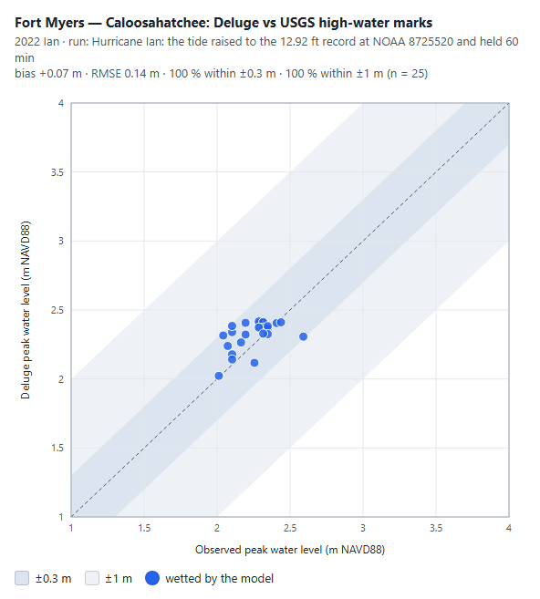

| | Value |
| --- | --- |
| Marks / sites | 29 accepted at 25 sites (3 rejected as Poor quality) |
| Wetted by the model | 25 of 25 |
| Bias / RMSE / MAE | **+0.07 m / 0.14 m / 0.11 m** |
| Within ±0.3 m / ±1 m | 100 % / 100 % |
| Worst | −0.28 m at 3225 E Riverside Dr (observed 2.59 m, the highest mark in the set) |

**What this does and does not show.** The run is forced with the *measured* peak at the gauge, 1–4 km from the marks.
So this is not a test of predicting Ian's surge; it tests whether the surge, once at the gauge, spreads over the
city's real terrain to the right height everywhere — whether low streets fill, whether the water surface stays
level across the domain, whether the DEM is registered to the marks. It does: the modelled peak surface ranges
2.02–2.42 m over the marks against 2.01–2.59 m observed, and the DEM implies 0.1–1.5 m of water at the marks
(observed WSE minus DEM ground), consistent with the surveyed heights above ground. A flat bathtub at the gauge level
would score similarly; Ian's surge in an 8 km domain behind the river mouth was close to one.

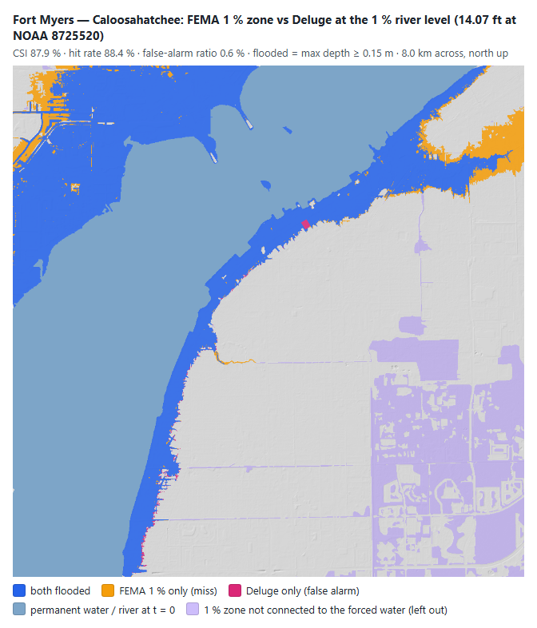

At FEMA's 1 % stillwater (14.07 ft on the gauge, above the slider's 13.7 ft top — the run sets it directly):

| Comparison | CSI | Hit rate | False-alarm ratio | Frequency bias |
| --- | --- | --- | --- | --- |
| 1 % zones connected to the sea | **87.9 %** | 88.4 % | 0.6 % | 0.89 |
| every 1 % zone in the domain | 57.8 % | 58.0 % | 0.6 % | 0.58 |

The misses (orange) are the 1 % zone's inland fringe in the north-west and north-east corners. FEMA's coastal BFEs
include wave effects on top of the stillwater, so its zone reaches further inland than a still level at 8.67 ft does —
the likeliest reason, though not separated here. The left-out zones (lilac) are 1 % zones not connected to the sea
over the terrain.

## Nashville — Cumberland River at FEMA's 1 % level

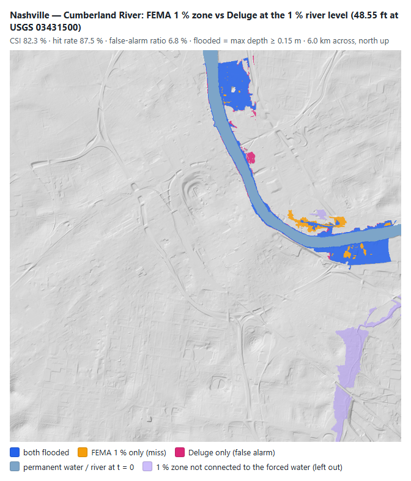

| | Value |
| --- | --- |
| FEMA 1 % level at USGS 03431500 | 416 ft NAVD88 = 48.55 ft on the gauge (the 2010 flood crested at 52.55 ft) |
| CSI (connected zones) / all zones | **82.3 %** / 53.9 % |
| Hit rate / false-alarm ratio / frequency bias | 87.5 % / 6.8 % / 0.94 |
| Water surface vs 1 % profile (10 BFE lines) | **bias +0.26 m, RMSE 0.27 m**, 7 of 10 within ±0.3 m |
| 0.2 % zone flooded | 2.4 % |

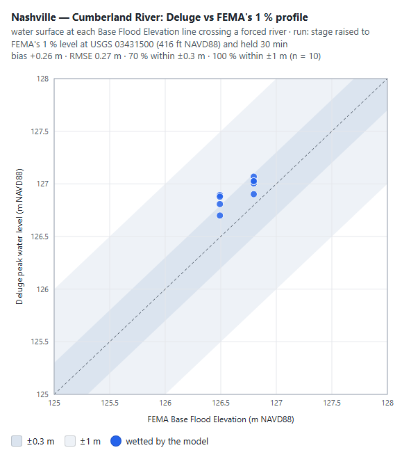

The best riverine agreement of the set. The modelled surface is 0.1–0.4 m above FEMA's profile everywhere; the misses
(orange) are low pockets of the east-bank floodplain that FEMA maps below the 1 % level but that the model's water
does not reach, or reaches less than 0.15 m deep, within the 30-minute hold.

## Nashville — the Cumberland flood of 1–3 May 2010

Two days of rain (13.57 in at the airport) put the Cumberland at Nashville to its highest level since the Corps'
dams were built: **52.55 ft on USGS 03431500 on 3 May 2010** (the USGS annual peak, 188,000 ft³/s; the NWS lists
the same crest — the scene's slider marks the 2010 flood at 51.86 ft). No USGS high-water marks exist for it, but
the Metropolitan Government of Nashville and Davidson County surveyed the damage afterwards: a windshield assessment
by Metro Stormwater and Metro Codes of every parcel whose structure was damaged "based on outward appearance",
published as a public map service. 563 damaged parcels lie in the domain.

The run raises the stage to the gauged 52.55 ft through the app's ramp and holds it 30 min. The real crest stood
above 50 ft for about a day, so the like-for-like comparison is the steady flood at that level: holds of 30, 60, 120
and 240 min flood the same 172 footprints and the same land to 0.2 %, so 30 min (the FEMA run's hold) is steady.

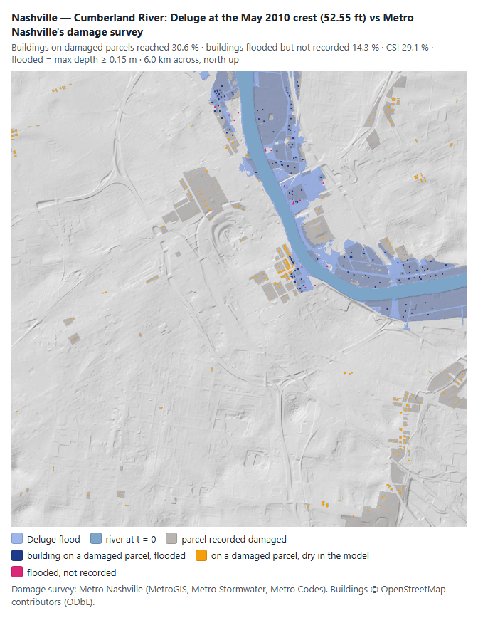

**How it is scored** (`src/validation/score.ts` scoreDamage). The survey lists damaged parcels only, so on its own it
could only say what the model reaches, never what it floods wrongly. The population that makes it two-sided is every
building footprint the scene has (OpenStreetMap, 13,668 compared): a footprint is *damaged* when at least half of its
cells (or, for one smaller than a cell, the cell under its centroid) lie on a damaged parcel, and *flooded* when the
model puts ≥ 0.15 m on any of its cells. A **crest-reach mask** — ground below the crest level and connected to the
river through ground below it, a flat surface at the gauge — sorts the damage into what the river could have done
and what it could not; it never scores the model's own water.

| Buildings | CSI | Hit rate | False-alarm ratio | Frequency bias | Hits | Misses | False alarms |
| --- | --- | --- | --- | --- | --- | --- | --- |
| all 13,668 in the domain | **29.1 %** | **30.6 %** | **14.3 %** | 0.36 | 132 | 299 | 22 |
| the 161 within the river's reach at the crest | 84.3 % | **98.5 %** | 14.6 % | 1.15 | 129 | 2 | 22 |

Of the 431 buildings on damaged parcels, **300 (70 %) stand above the crest or behind higher ground**, and only 82
(19 %) touch FEMA's 1 % zone. The model floods 45 % of the damaged parcels' land.

**Reading it.** Where the Cumberland could reach at its crest, Deluge reaches it: 129 of 131 damaged buildings, and
the 22 buildings it floods that the city did not record (14 % of what it floods) are on the same waterfront (not
separated here: no visible damage from the street, a parcel the survey did not reach, or a model error). Inside the
reach this is close to a bathtub test (8 buildings in reach stay dry); the level, not the hydraulics, decides it.
The 299 misses are the larger finding: seven in ten damaged buildings in this domain were damaged by something a
river-stage scene does not run — the creeks (the south-east cluster is along Browns Creek), rain on the city, storm
drains backing up under a river 12 ft above flood stage (the downtown cluster just inland of the riverfront stands
above the crest level), and basement and utility damage that a windshield survey records as damage. Damage is not inundation, and this is not a skill
score for those floods; it is a measured statement of how much of a real city's flood damage the river alone
explains, which is what a buyer of a river-stage model needs to know.

Not tuned: the stage is the gauged peak, the hold is set by steadiness, the 0.15 m threshold and the one-half rule
were fixed before the comparison, and the crest-reach mask comes from the DEM and the gauge alone.

## Pittsburgh — Three Rivers at FEMA's 1 % level

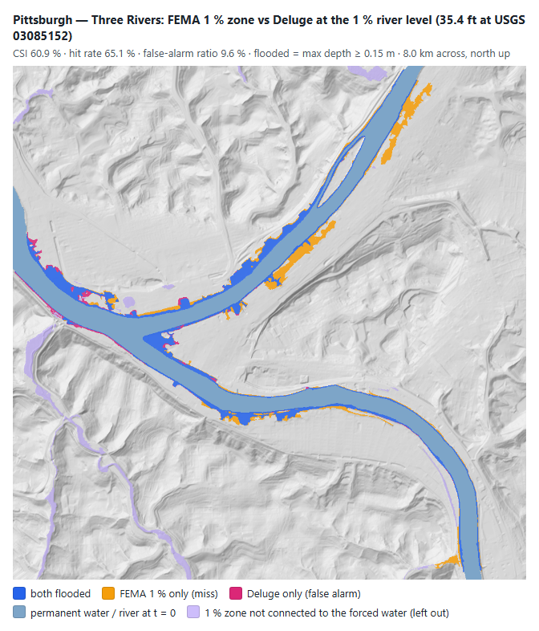

| | Value |
| --- | --- |
| FEMA 1 % level at the Point gauge (USGS 03085152) | 729 ft NAVD88 = 35.4 ft (Agnes 1972 was 35.8 ft) |
| CSI (connected zones) / all zones | **60.9 %** / 45.6 % |
| Hit rate / false-alarm ratio / frequency bias | 65.1 % / 9.6 % / 0.72 |
| Water surface vs 1 % profile (24 BFE lines) | **bias −0.38 m, RMSE 0.71 m**, 7 of 24 within ±0.3 m, 19 within ±1 m |

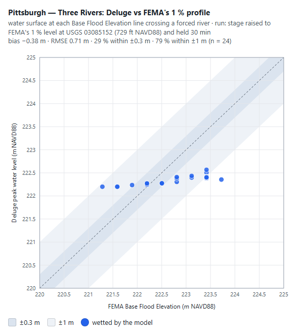

**Why it misses.** The profile table explains the map. FEMA's 1 % surface rises 2.4 m across the domain, from 726 ft
on the Ohio at the west edge to 733–734 ft up the Allegheny and Monongahela. Deluge's surface is almost flat: 222.2 m
on the Ohio to 222.4–222.6 m upstream, because the stage boundaries hold the three rivers within ±0.2 m of the gauge
level (`WaterSource.offsetScale`, ARCHITECTURE.md §4) — a 1 % *discharge* through these channels would need a much
steeper surface. So the model is 0.6–0.9 m high on the Ohio and 0.7–1.4 m low upstream, and the orange misses are
exactly the upstream floodplains (Lawrenceville and the Strip along the Allegheny, the Mon's south bank). The fix is a
steeper confluence head that grows with stage, or a discharge boundary upstream; it is not attempted here, because
tuning it on this comparison would make the comparison meaningless.

## Asheville — Hurricane Helene, 27 September 2024

The scene runs both rivers at their Helene peak discharge (French Broad 3,200 m³/s, Swannanoa 1,722 m³/s). The peak
water level is compared with the USGS peak stage at the two gauges inside the domain, converted with the gauge datums
NWIS lists in NAVD88.

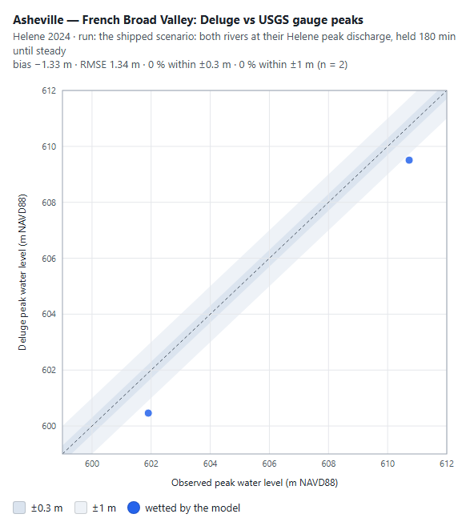

| Gauge | Observed peak | Deluge | Deluge − observed |
| --- | --- | --- | --- |
| 03451500 French Broad River at Asheville | 24.82 ft + 1949.93 ft datum = **601.90 m** | 600.46 m | **−1.44 m** |
| 03451000 Swannanoa River at Biltmore | 27.33 ft + 1976.37 ft datum = **610.73 m** | 609.51 m | **−1.22 m** |

The run holds both peaks for 180 simulated minutes. This matters: at 90 minutes the French Broad gauge was still
1.5 m short — the peak had not yet travelled the 7 km to it — and at 180, 240 and 360 minutes the levels agree to 1 cm,
so 180 min is the steady peak, which is the like-for-like comparison with a peak that lasted hours.

**Why it is low.** With the right discharge the level is controlled by the channel's conveyance, and three things in
the model give it too much: (1) **one Manning's n (0.035) for everything** — a clean-channel value, applied to wooded
banks, built-up floodplain and a debris-laden flood; (2) the **burned channel**: 3DEP's river surface is
hydro-flattened, so the bake cuts a channel of assumed depth below it (ARCHITECTURE.md §5), which can carry more than
the real bed; (3) **bare earth** — bridges, embankments and buildings that constrict the real flow are not in the DEM.
As a sensitivity only (not adopted): at n = 0.05 the steady residuals become −0.64 and −0.67 m. Choosing n from this
comparison would be calibrating on the validation data.

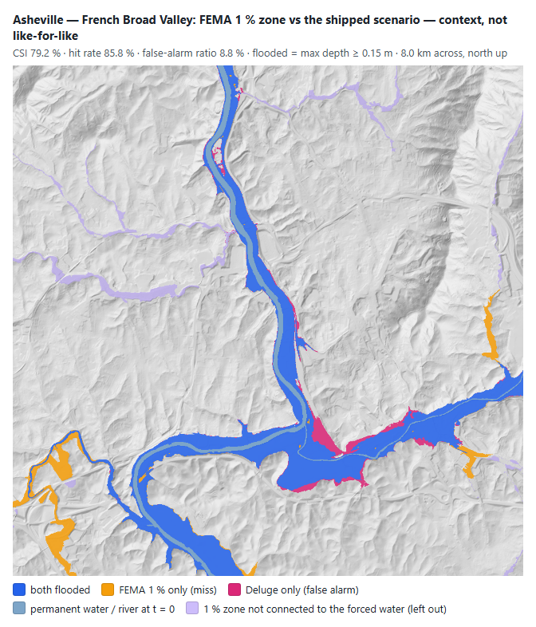

For context only (Helene was far beyond the 1 % flood): the Helene run floods 81 % of the 1 % zone connected to the two
rivers, and 6 % of what it floods lies outside it.

## Houston — Hurricane Harvey, August 2017

The scene is *Harvey's worst hour*: 173 mm/hr over the whole domain with Buffalo Bayou at its 923 m³/s peak, for
60 simulated minutes. The USGS marks inside the domain record the **peak of a four-day flood** with the Addicks and
Barker releases behind it. This comparison is therefore **not like-for-like**, and is reported because the marks are
the best observed data this domain has.

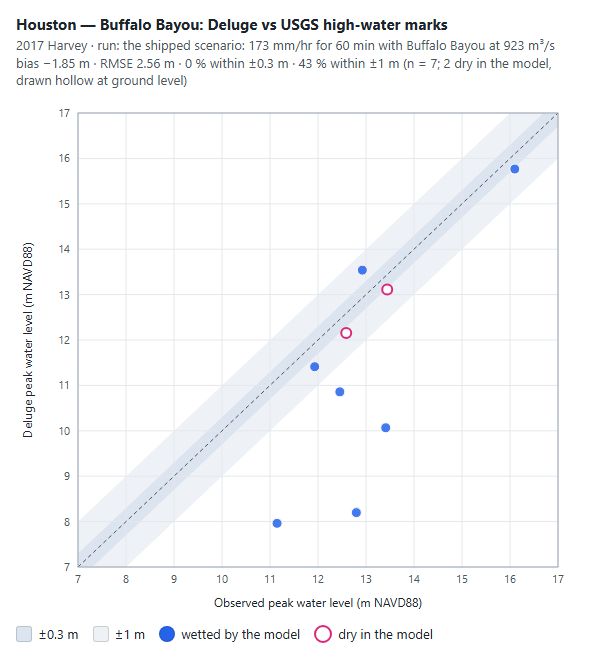

| | Value |
| --- | --- |
| Marks / sites | 13 accepted at 9 sites (44 rejected: 37 type *Other*, 4 tape-downs, 3 Poor/Very Poor) |
| Wetted by the model | 7 of 9; 2 dry (Stude Park, Bayou Bend hilltop) |
| Bias / RMSE (wetted) | −1.85 m / 2.56 m; within ±1 m: 3 of 7 |
| All 9, dry marks at ground (flatters the model) | bias −1.53 m, RMSE 2.26 m |

The model is low everywhere but one mark, as it must be: one hour of rain and a steady bayou cannot reach the peak of
four days. Run as a sensitivity for 3 hours of the same forcing, the bias falls to −1.20 m (RMSE 1.46 m) — still low,
still not the event. The largest misses (−3.2 to −4.6 m, downtown at Fannin St, at the Jackson Hill bridge and at the
Rienzi pool) are on Buffalo Bayou, where the bayou's own Harvey stage — raised for days by the reservoir releases —
set the mark. Of the two White Oak Bayou marks one is within 0.33 m and one is dry: White Oak Bayou is not forced in
this scene at all.

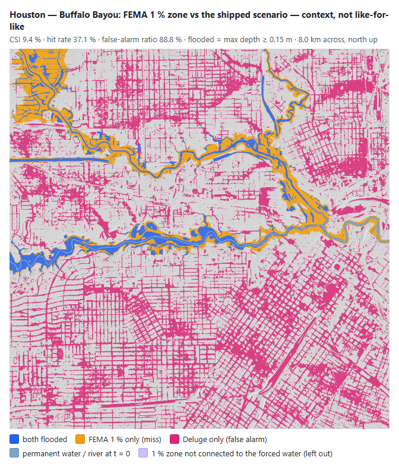

For context: the Harvey hour floods 37 % of the 1 % zone and 89 % of what it floods (0.15 m or more) lies outside it —
streets and blocks ponding under 173 mm/hr with no storm drains. That is not a model error in itself — Harris County
Flood Control District's post-Harvey assessment found most of the homes that flooded were outside the mapped 1 %
floodplain — but it is not a skill score either.

## Betrawati, Nepal — the Trishuli debris flood, 26 August 2026

Copernicus EMS mapped this event (activation EMSR927); its AOI 03 (Bidur) covers the valley floor at the south of
the domain. The grading product (monitoring 1, PeruSAT-1 27 Aug and Resurs-P 28 Aug) has no flood-extent polygon,
but it grades every building and road segment: destroyed, damaged, possibly damaged, or no visible damage.

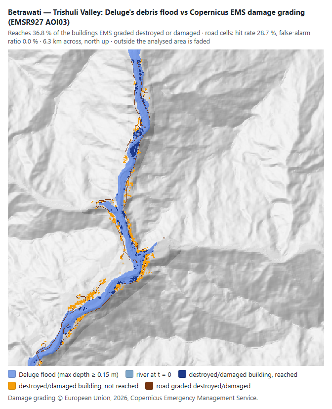

| | Value |
| --- | --- |
| Buildings graded destroyed / damaged / possibly damaged (in domain and analysed area) | 1,323 / 70 / 64 |
| Destroyed or damaged reached by the modelled flood (≥ 0.15 m within one cell) | **40.1 %** (558 of 1,393) |
| … within 30 m of the modelled flood (one 30 m DEM cell) | 59.2 % |
| Road cells: destroyed/damaged vs no visible damage | CSI 32.0 %, hit rate 32.0 %, **false-alarm ratio 0 %** |

**Reading it.** The model never floods a road EMS saw undamaged, but it reaches only two fifths of what EMS graded
destroyed: its flood is too narrow. Part of that is the comparison — damage is not inundation; buildings on the
banks were undercut and collapsed, slopes failed (the EMS product maps landslides in the AOI), and grading from
optical imagery days later sees debris and erosion, not water — and a third of the misses are within 30 m, one cell of the
Copernicus GLO-30 DEM the terrain comes from. Part is the model: the inflow is the hazard chain's routed median member
(`src/hazard`), not a measured hydrograph, and a 30 m radar DEM through a bare-earth filter has neither the narrow
valley-floor detail nor the bed that this flood actually ran on.

## Boulder, Ellicott City, Johnstown — context only

None of these scenes has surveyed high-water marks or a mapped observed extent in a public database (Boulder Creek's
2013 STN marks are all outside the domain; Ellicott City's 2016 survey is a county report, not data; Johnstown is
1889). Their shipped scenarios are historic events, not the 1 % flood, so the FEMA comparison is context, not skill:

| Scene | Run | 1 % zone flooded (connected) | Flood outside the 1 % zone | CSI |
| --- | --- | --- | --- | --- |
| Boulder | 238 m³/s out of Boulder Canyon, 60 min | 40 % | 19 % | 37 % |
| Ellicott City | 110 mm/hr storm cell + the Patapsco 2016 peak, 60 min | 60 % | 50 % | 38 % |
| Johnstown | 1889 dam-break inflow, 60 min | 61 % | 38 % | 45 % |

Maps: [Boulder](validation/boulder-fema-extent.png) · [Ellicott City](validation/ellicott-fema-extent.png) ·
[Johnstown](validation/johnstown-fema-extent.png).

## Chamoli and Chungthang

There is no Copernicus EMS activation for either event and no public surveyed extent or high-water marks inside
either domain. What can be checked — the hazard chain's arrival times and reconstructed peaks at named stations
(Shugar et al. 2021; Sattar et al. 2025) — is checked in `tests/hazard` and described in
[docs/research/glacier-hazard-chain.md](research/glacier-hazard-chain.md). The app's Validation block says so rather
than showing a number.

## Buildings, a land-cover roughness map and storm drains

The app has three optional land-surface layers (Advanced → *Land surface*; [ARCHITECTURE.md §3.11](../ARCHITECTURE.md#311-land-surface-buildings-as-obstacles-a-roughness-map-storm-drains)):
buildings — a block where footprints fill a cell, an integral porosity where they only partly cover it, and roof rain
sent down the downspouts — Manning's n from NLCD 2021, and storm drains sized to the 2-year storm. The scenes above
were re-run with each of them, through the same runs and the same scoring (`npx tsx
scripts/validation/landsurface.ts`; a blocked cell is scored at the water surface of its wettest open neighbour, the
level a mark on its wall would record; a porous cell at the depth of its open part):

| Scene and observation | none (shipped) | buildings | roughness | buildings + roughness | drains | all three |
| --- | --- | --- | --- | --- | --- | --- |
| Fort Myers, Ian marks: bias / RMSE | +0.07 / 0.14 m | +0.04 / 0.16 m | +0.01 / 0.17 m | +0.04 / 0.15 m | | |
| Fort Myers, FEMA 1 % zone: CSI | **87.9 %** | 85.8 % | 80.9 % | 85.7 % | | |
| Nashville, FEMA 1 % zone: CSI / profile bias | **82.3 %** / +0.26 m | 80.2 % / +0.27 m | 79.3 % / +0.24 m | 79.4 % / +0.27 m | | |
| Pittsburgh, FEMA 1 % zone: CSI / profile bias | **60.9 %** / −0.38 m | 60.5 % / −0.38 m | 59.1 % / −0.40 m | 60.8 % / −0.38 m | | |
| Asheville, gauge peaks: French Broad / Swannanoa | −1.44 / −1.22 m | −1.44 / **−0.49 m** | −1.69 / +0.00 m | −1.41 / −0.55 m | | |
| Houston, Harvey marks (not like-for-like): bias / RMSE | −1.85 / 2.56 m | −1.01 / 2.39 m | −1.87 / 2.44 m | | −1.89 / 2.61 m | −1.07 / 2.47 m |

Before the porosity and downspouts (building blocks by cell centre alone), the buildings column read 86.6 %, 80.2 %,
60.5 %, −1.45 / −1.27 m and −1.01 / 2.40 m: the extent scores moved by under a point, and the Swannanoa gauge came
0.7 m closer to its observed peak (still short of it, like the French Broad).

No layer improves every like-for-like score, so none is on in the shipped scenes. Buildings cost 0.4–2.1 CSI points,
the roughness map 1.8–7.0, the two together 0.1–2.9. Two things are behind that, measured rather than assumed:

* **The fixed hold.** The stage is held 30 min (60 min at Fort Myers) after it arrives, and FEMA's 1 % zone is where
  water would stand with no time limit. Anything that slows the water leaves fringe cells short at the end of the
  hold. Re-run with every hold three times as long (`--hold-scale=3`, a sensitivity, not the protocol), the roughness
  map's loss shrinks to 0.6 points at Fort Myers (90.6 % against 90.0 %), 0.8 at Nashville and 1.2 at Pittsburgh,
  and buildings' to 0.8 at Fort Myers and 0.3 at Pittsburgh.
* **Watertight buildings.** At Nashville the buildings' loss grows with the longer hold (81.4 % against 77.4 %): of
  the 781 zone cells bare earth wets and buildings do not (standard hold), 651 are open ground that stays completely
  dry — pockets the buildings shut off. A real flood reaches them through doors, garages and courtyards; the model's
  blocks do not leak, and FEMA maps the pockets by their ground elevation.

The Manning's n values themselves were checked, not tuned: the land-cover raster is registered on the grid (the
share of river cells on NLCD's water class is highest with no shift and falls for any shift of 4 cells; a live
re-fetch reproduces the baked raster exactly), every river cell keeps the uniform 0.035 the scenes were set up with,
and the class values sit inside the HEC-RAS 2D manual's ranges. The roughness map moves the two Helene gauges in
opposite directions, so Asheville's error is the discharge and the burned channel, not the floodplain's n. The
layers remain available for what they do model (flow round and between buildings, drained ordinary storms), with the
caveats in ARCHITECTURE.md.

## What these numbers do not cover

* **Bare-earth terrain, no drains.** Every U.S. DEM is 3DEP bare earth at the preset's 4.9–7.8 m cells: no buildings
  (the app draws them; the solver sees them only with the optional *Buildings block flow*), no storm drains (optional,
  off), no culverts, no flood walls unless the DEM carries them. Pluvial scenes (Houston, Ellicott City) are the most
  affected.
* **One roughness.** Manning's n is 0.035 everywhere. A land-cover map is optional and did not score better (above):
  it does not close Asheville's −1.3 m either, which points at the discharge and the burned channel instead.
* **Scenario simplifications.** Stage scenes hold a nearly level water surface between their boundaries (Pittsburgh's
  profile); event scenes run a constant peak or one hour of rain, not the event's hydrograph (Houston).
* **Small samples.** 25, 9 and 2 points, three like-for-like extent maps and one city damage survey. The FEMA zone is itself a model
  (FEMA's own hydraulics, often decades old), not an observation of a flood; it is the reference an insurer or
  lender uses, which is why it is here.
* **One machine.** Numbers were produced on an NVIDIA GTX 1660 Ti (D3D12); the regression test's tolerances cover
  another GPU's Float32 rounding and CFL timing.

## Data and licences

| Data | Source | Licence | Used for |
| --- | --- | --- | --- |
| High-water marks, Harvey (event 180) and Ian (event 325) | USGS Short-Term Network / Flood Event Viewer, `stn.wim.usgs.gov/STNServices` | Public domain (USGS) | Houston, Fort Myers |
| Annual peak stage and gauge datum, 03451500 and 03451000 | USGS NWIS, `nwis.waterdata.usgs.gov/nwis/peak`, `waterservices.usgs.gov` | Public domain (USGS) | Asheville |
| Flood Hazard Zones (layer 28), Base Flood Elevations (16), Coastal Transects (15) | FEMA National Flood Hazard Layer, `hazards.fema.gov/arcgis/rest/services/public/NFHL/MapServer` | Public domain (U.S. Government work) | the eight U.S. scenes |
| Damage grading, EMSR927 AOI 03 GRA_MONIT01 | Copernicus Emergency Management Service Rapid Mapping, `rapidmapping.emergency.copernicus.eu` | © European Union, 2026, Copernicus EMS; free use with attribution | Betrawati |
| May 2010 flood parcel damage assessment (layer 1, "Parcels with Damaged Structure") | Metropolitan Government of Nashville and Davidson County — MetroGIS, Metro Stormwater, Metro Codes; `maps.nashville.gov/arcgis/rest/services/May2010Flood/May2010_DamageParcels/MapServer` | Public record, published as a public map service; no licence stated, used with attribution. Only the parcel geometry is requested and only a rasterised mask is committed — the layer's owner names, addresses and parcel IDs are never downloaded | Nashville 2010 |
| 2010 crest and gauge datum, 03431500 | USGS NWIS annual peaks and site file | Public domain (USGS) | Nashville 2010 |

Searched and not available for a domain: USGS STN marks for Helene in North Carolina (the event's STN records are in
FL, SC and VA; USACE's Helene marks are a report, not a dataset), for the May 2010 Nashville flood, for the 2016
Ellicott City flood and inside the Boulder domain; Copernicus EMS activations for Chamoli 2021 and Sikkim 2023.
In October 2026 every one of the STN database's events was checked against every U.S. domain: only Harvey (Houston)
and Ian (Fort Myers) have surveyed NAVD88 marks inside one — Irma's 506 and Helene's 321 marks have none inside the
Fort Myers domain, and the Milton and Beryl events hold almost no marks at all. The STN does hold digitised historical
marks inside two domains — "1972 Jun OH Flood" (Agnes) and "2004 Sep OH Flood" (Ivan) at Pittsburgh (8 and 5), and
the 1889, 1936 and 1977 floods at Johnstown (3, 17 and 32) — but every one is type
*Other*, quality *Unknown/Historical*, on a "local control point" datum and mostly taken at bridges; the datum rule
refuses them (one Agnes mark at the Point gauge equals the gauge's NGVD29 crest, which suggests that datum, but
"suggests" is a guess this page does not make).

Raw downloads are cached under `artifacts/validation/raw/` (not committed). What is committed is the compact
extract per scene in `public/validation/<scene>/`: `observed.json` (screened marks merged by site, with every rejected
mark and its reason; gauge peaks; the FEMA 1 % level and BFE lines; EMS grades — each with source, URL, licence and
retrieval date) and `fema-zones.json` (the NFHL zones rasterised onto the scene's grid, run-length encoded).

## Reproduce

```
npx tsx scripts/validation/fetch.ts        # observed data → public/validation/ (raw cache: artifacts/validation/raw)
npx tsx scripts/validate.ts                # run every scene on the GPU, score, write summary, tables, figures
npx tsx scripts/validate.ts --score-only   # re-score the saved fields without a GPU
```

`scripts/validate.ts` writes `public/validation/summary.json` (the app's block and the pinned metrics),
`artifacts/validation/results.md` (every table on this page, with every mark), and the figures in
`docs/validation/`. The whole set is ~10 runs and 2–12 minutes of GPU time depending on the machine and its load.

**Regression.** `tests/sim/validationRegression.test.ts` (part of `npm test`) re-runs every scene and fails if any
published metric moves by more than ±0.10 m (levels), ±3 points (shares and skill scores), ±0.05 (frequency bias) or
±1 (counts of dry marks). It is not an accuracy gate — several numbers above are poor and say so — it makes a physics
change show its effect on agreement with reality. After an intended change, re-run `scripts/validate.ts` and update
this page. `DELUGE_VALIDATION=pittsburgh,ftmyers` runs a subset; `DELUGE_VALIDATION=0` skips it. The metric
arithmetic, datum conversion and mark screening are unit-tested in `tests/validation/`.
